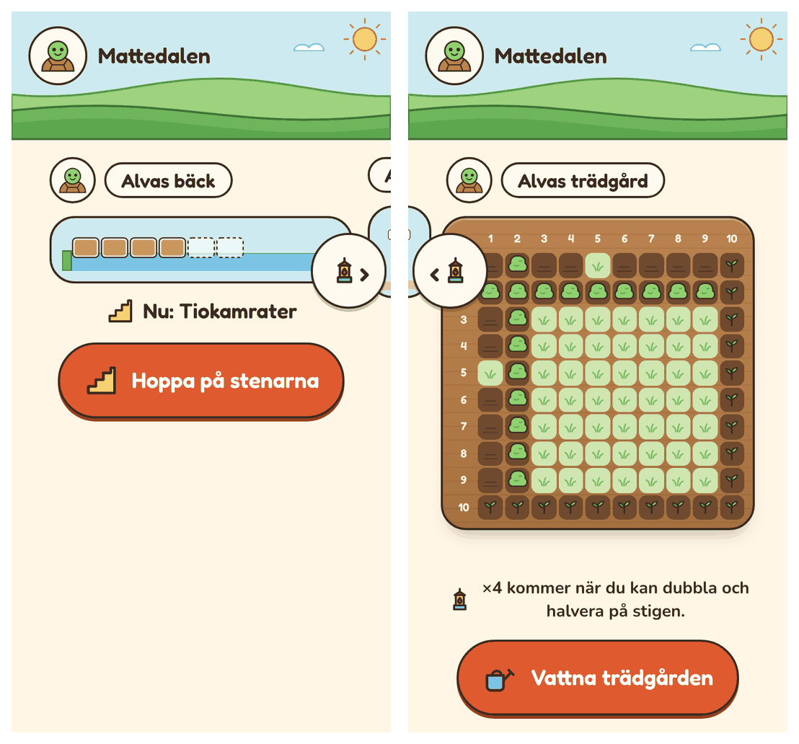
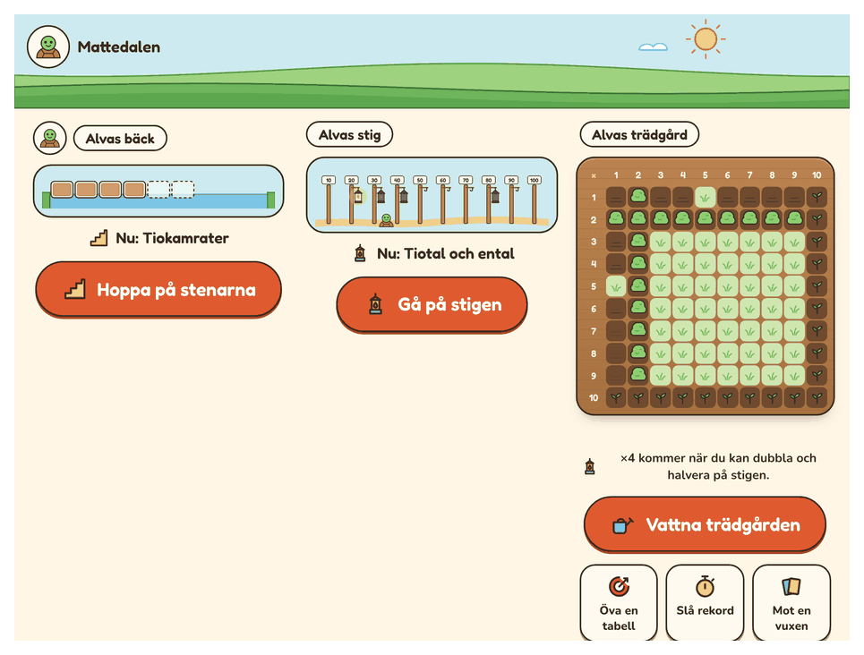
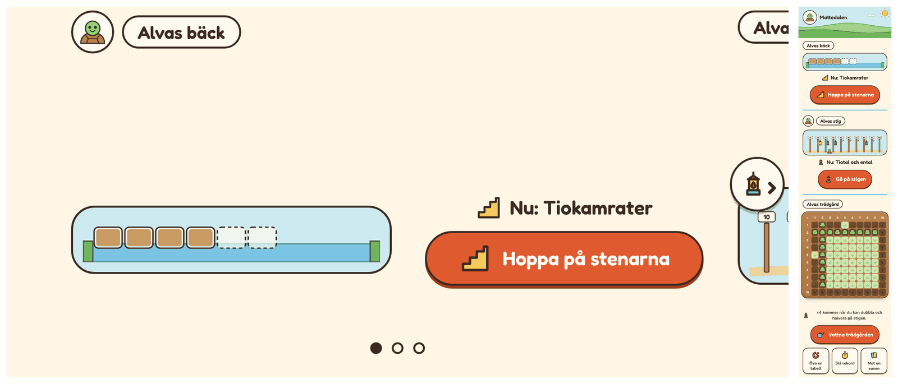

# Plan: dalen som svepbar värld (R3)

Dalen blir en rad scener, en per plats. Barnet sveper mellan dem. Varje scen
visar platsen som den är, med bron, lyktorna eller lådan, och har platsens egen
knapp. Platssidorna går upp i scenerna. Förslaget kommer från granskningen
(se [PLAN-GRANSKNING.md](PLAN-GRANSKNING.md)).

## Varför

- **Kartan är både meny och värld.** Då blir platserna små symboler: åtta buskar
  i stället för den riktiga lådan.
- **Två tryck innan passet börjar:** först platsen på kartan, sedan knappen på
  platsens sida.
- **Kartan måste ritas om** för varje ny plats. Scener blir bara fler.

## Bilder

Bilderna är en attrapp, byggd av appens egna delar: bron, stigen och lådan som
de ser ut för ett barn, med raden ”Nu: …” och platsens knapp.

*Telefon, 360 px. Till vänster börjar dagen vid bäcken. Stigen syns i kanten, och
pilen med lyktan visar att den har något att visa. Till höger har barnet svept
till trädgården.*

*Surfplatta liggande, 1080 px. Alla scener får plats, så inget sveps.*

*Liggande telefon: en scen i taget, bilden till vänster och knappen till höger.
Längst till höger: samma scener staplade lodrätt, som alternativ för piloten.*

## Så fungerar det

- **En scen per plats,** i ordningen Bäcken, Stigen, Trädgården. Det är den
  ordning barnet möter dem. Kartan i dag ritar trädgården först, eftersom den
  fanns först.
- **I varje scen:** platsens namn, bilden i verkligt skick, raden ”Nu: …” eller
  vad som väntar, och platsens knapp. Trädgården har sina extra knappar under
  lådan.
- **En vilande plats** visar månen, ”Kom tillbaka i morgon” och ”Öva lite till”.
  **En stängd plats** vilar, med raden om när den öppnar.
- **Svep med snäpp.** Varje scen är 80 % av bredden, så att grannarna syns i
  kanten. Den som inte ser att det går att svepa sveper inte.
- **Pilar i kanten** på 72 px, med grannens ikon: droppen när trädgården är
  törstig, lyktan, stenen. Pilarna ersätter raderna till höger på kartan och
  fungerar för barn som inte läser.
- **Prickar** under scenerna visar var barnet är.
- **Dagen börjar vid dagens första plats,** den som knappen föreslår i dag, inte
  alltid längst till vänster.
- **Sköldpaddan** står vid scenens namn och går med när barnet sveper. Ett tryck
  på den tar barnet till dagens plats. Byt spelare görs som i dag, med djuret
  uppe till vänster.
- **Breda skärmar** visar alla scener bredvid varandra, utan snäpp och utan
  pilar. Det gäller från cirka 1020 px bredd i liggande läge. En surfplatta på
  högkant sveper.
- **Liggande telefon:** en scen per skärm, med bilden till vänster och knappen
  till höger.
- **Tillbaka från ett pass** leder till världen, vid samma scen. Det gäller
  ”Tillbaka till stigen” och slutskärmens knapp.
- **Startkoll och koll** erbjuds när barnet trycker på scenens knapp, som i dag
  på platssidan.

## Regeln om sidled

Regeln ”inget rullar i sidled” skrivs om:

- **Sidan rullar aldrig i sidled.** Världen panoreras inuti en egen behållare
  (`overflow-x: auto`, `overscroll-behavior-x: contain`).
- **Behållaren är positionerad** (`position: relative`). Annars kan text som
  bara finns för skärmläsare hamna utanför den och få hela sidan att rulla. Det
  hände i attrappen.
- **Testerna** för smala och liggande telefoner mäter sidan, som i dag, och får
  ett eget test för att världen sveper.

## Fallgropar

- **Androids bakåtgest från kanten** kan krocka med svepet. Världen får en fri
  kant på 16 px på varje sida, och bakåt i dalen gör ingenting nytt. Följs upp i
  piloten.
- **Tillgänglighet:** pilarna har namn (”Till stigen”), piltangenterna vänster
  och höger byter scen, och scenerna är en lista med rubriker. En skärmläsare
  läser platserna i ordning. Med `prefers-reduced-motion` hoppar världen utan
  att glida, och sköldpaddan går inte.
- **Storlekar efter scenen, inte efter fönstret.** Lådans rutor räknas i dag
  från fönstrets bredd och höjd. I scenen räknas de från scenens bredd
  (container queries). Utan det blev lådan för stor i attrappen.
- **Uppläsning:** knappen ”Läs upp” läser scenens rad.

## Lodrätt som alternativ

Granskningen föreslog också lodrät rullning nedför bäcken. Det är tummens
naturliga rörelse på en telefon och krockar inte med systemgester. Samma scener
kan staplas lodrätt med vanlig rullning. Vi bygger båda lägena i samma
komponent, med vågrätt som standard. En inställning i föräldravyn (”Dalen: svep
i sidled / rulla nedåt”) låter piloten pröva båda.

## Vad som ändras i koden

- **`Place`** får `scene(ctx, profile)`, som ritar scenen: bilden, raden och
  knapparna. Den ersätter `onMap` och platssidan. `open` blir att börja platsens
  pass, med kollen först när den är dags.
- **`shell/components/world.ts`** är världen: scenerna, snäpp, pilar, prickar,
  tangenter och de två lägena. `shell/screens/valley.ts` blir tunn.
- **Platssidorna** (`brook.ts`, `path.ts`, `garden.ts`) delas. Det som ritar
  scenen flyttar till en scenfunktion, och sidorna försvinner.
- **CSS:** storlekar med `cqi` efter scenens bredd. Lådans `--cell` räknas från
  scenen.
- **Dagens plan och den senaste platsen** fungerar som i dag.

## Faser

| Fas | Innehåll |
|---|---|
| R3a. Världen **(klar)** | Komponenten med scener av platsernas egna delar, snäpp, pilar, prickar, tangenter, startscen och breda skärmar. Platssidorna finns kvar bakom scenens knapp. |
| R3b. Platssidorna i scenerna | Scenens knapp börjar passet. Tillbaka-knappar och slutskärmar leder till scenen. Trädgårdens extra knappar och rader flyttar in i scenen. |
| R3c. Lodrätt och verifiering | Lodrätt läge och inställningen för piloten. Tester för svep, pilar, tangenter och skärmläsare. Skärmbilder i alla storlekar, dokumenten och regeln om sidled. |

## Fynd från R3a

- **Scenerna är byggda av platsernas egna bilder.** `brookPicture`,
  `pathPicture` och `gardenPicture` ritar bron, stigen och lådan både på
  platssidan och i scenen. Kartans små varianter (minilådan, fröpåsen, valvbron
  och den lilla stigen) är borttagna.
- **Lådan i scenen är en bild, inte knappar.** Rutorna är `aria-hidden`, och
  lådan beskrivs i ord för skärmläsare, som på platssidan. Annars skulle
  scenen ha 100 knappar till en skärmläsare.
- **Skylten behöver inga stolpar** i scenen. Stolparna hörde till kartans mark.
- **Världen måste snäppa om när fönstret ändras.** Utan det visade en vriden
  telefon fel scen, och prickarna och pilen sa olika saker. Världen följer nu
  sin storlek och står kvar vid samma scen.
- **Två snabba tryck på pilen** gick bara ett steg. Medan världen gled mot
  scenen räknades scenen den passerade som barnets. Nu gäller den valda scenen
  tills världen har stannat.
- **Djuret står inte längre vid den senaste platsen.** Dalen börjar vid dagens
  plats. Att komma tillbaka till samma scen efter ett pass kommer i R3b.
- **Ordningen ändrar dagens plan vid lika.** Dagens två platser väljs efter vad
  som är förfallet, och vid lika vinner den första i dalen. Med Bäcken först
  kan Trädgården vila en dag där den tidigare vann.

## Beslut

Beslutat i oktober 2026, enligt förslagen:

1. **Ordningen** är Bäcken, Stigen, Trädgården, som barnet möter dem.
2. **Scenens knapp** börjar passet direkt, en tryckning mindre.
3. **Lodrätt läge** blir en inställning för piloten.
