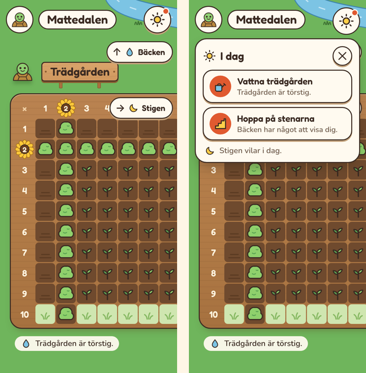
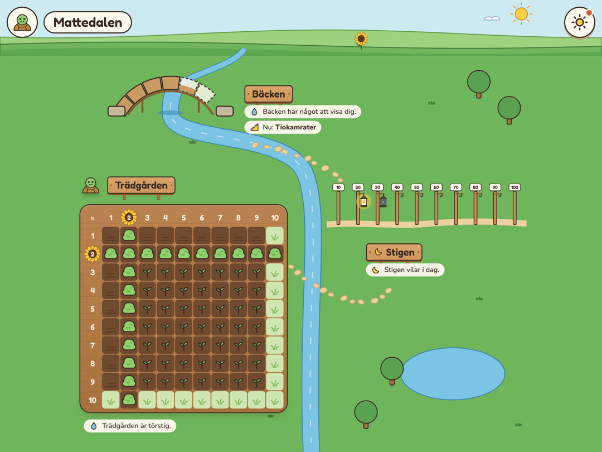

# Plan: dalen som en karta att dra runt i (R3)

Dalen blir en stor karta som fyller hela skärmen. Varje plats står i full
storlek: bron över bäcken, stigen med lyktorna och hela odlingslådan. På en
telefon är kartan större än skärmen, och barnet drar runt i den med fingret.
På en surfplatta eller dator syns hela dalen på en gång.

## Varför

- **Den gamla kartan var trång.** Alla platser fick plats i en ruta på cirka
  330 px. Då blev platserna små symboler: åtta buskar i stället för lådan.
- **Scenerna i R3a tappade dalen.** Varje plats blev ett kort som sveps i
  sidled. Det gav plats, men känslan av en dal försvann. Vi prövade det och
  valde bort det (se *Vad vi prövade* nedan).
- **Kartan kan växa.** En ny plats får en plats på kartan, och kartan blir
  större. Inget behöver tryckas ihop.

## Bilder

Bilderna är från en attrapp byggd av appens egna delar.

*Telefon, 360 px. Till vänster öppnar dalen vid trädgården. Pilarna i kanten
pekar mot bäcken och stigen. Till höger har barnet tryckt på solen i hörnet,
och ”I dag” visar vad som återstår.*

*Surfplatta liggande, 1080 px. Hela dalen syns, och inget behöver dras.*

## Så fungerar det

- **En karta, ingen ram.** Himlen och kullarna överst, sedan ängen. Bäcken
  rinner från kullarna, under bron och ner genom dalen. En stig av stenar går
  mellan platserna. Träd, en damm och tuvor fyller det fria.
- **Platserna i full storlek:**
  - **Bäcken:** valvbron över dalens egen bäck, en sten per del, med
    byggställningen under tills alla stenar ligger, som på den gamla kartan.
  - **Stigen:** stolparna med lyktorna, samma som på stigens sida.
  - **Trädgården:** hela lådan med alla rutor.
- **Vid varje plats** står skylten, dagens läge och raden ”Nu: …”. Ett tryck på
  skylten eller bilden leder till platsen.
- **Telefon:** kartan är större än skärmen. Barnet drar runt i den åt alla håll
  med fingret, utan zoom. Med mus går det att dra på samma sätt, och
  piltangenterna flyttar kartan.
- **Pilar i kanten** pekar mot platser utanför skärmen, med platsens ikon och
  namn (”↑ Bäcken”). Ett tryck glider dit. Pilarna skjuts isär längs kanten, så
  att de aldrig ligger på varandra eller på knapparna i hörnen.
- **Surfplatta och dator** visar hela dalen. Kartan skalas så att den får plats,
  och himlen och ängen når ut till kanterna. Det gäller när kartan får plats i
  minst 70 % av sin storlek.
- **Dalen öppnar vid dagens plats,** där barnets djur står.
- **”I dag” i hörnet.** En rund knapp med en sol uppe till höger visar med en
  liten prick att det finns något att göra i dag. Ett tryck öppnar ett litet
  kort med det som återstår, till exempel ”Vattna trädgården” och ”Hoppa på
  stenarna”. En rad startar passet. En plats som vilar står längst ner. När allt
  är gjort försvinner knappen. Ingen siffra visas.
- **Uppe till vänster** byter djuret spelare, som i dag. Knappen ”Läs upp”
  läser platsernas lägen.
- **Tillbaka från en plats** leder till kartan, vid samma plats.

## Regeln om sidled

- **Sidan rullar aldrig.** Kartan panoreras inuti en egen behållare som fyller
  skärmen (`overflow: auto`, `overscroll-behavior: contain`).
- **Testerna** för smala och liggande telefoner mäter sidan, som i dag, och
  provar att pilarna aldrig överlappar i många lägen på kartan.

## Fallgropar

- **Androids bakåtgest från kanten** kan krocka med att dra. Pilarna ligger 8 px
  in från kanten. Följs upp i piloten.
- **Tillgänglighet:** platserna är en lista med skyltar som knappar, i
  ordningen Bäcken, Stigen, Trädgården. En skylt som får fokus rullas in i
  bild. Pilarna i kanten är en genväg för den som ser, och döljs för
  skärmläsare. Med `prefers-reduced-motion` hoppar kartan i stället för att
  glida.
- **Storlekar i kartans egna enheter.** Platserna har fasta lägen och storlekar
  i kartan (1100 × 1040). Lådans rutor är 40 px där. På en bred skärm skalas
  hela kartan.
- **Pricken på solen** får inte bli en räknare. Den säger bara att något
  återstår.

## Vad som ändras i koden

- **`shell/components/valleyMap.ts`** är kartan: bäcken, stenarna, dragandet,
  skalningen, pilarna och startläget. Den ersätter `world.ts` från R3a.
- **`shell/valleyLayout.ts`** säger var varje plats står och hur bäcken och
  stigen går. Bäcken och stigen binder ihop platserna, så lägena hör till dalen
  och inte till platserna.
- **`Place.scene`** från R3a finns kvar: platsens bild, läge och rad. Bäcken
  ritar valvbron på kartan (`archBridge`) och den raka bron på sin egen sida.
- **”I dag”** (K2) använder platsernas `go` och startar passet, med kollen först
  när den är dags och startkollen första gången.
- **Platssidorna** finns kvar bakom skylten. Trädgårdens extra knappar och
  rutorna man trycker på stannar där.

## Faser

| Fas | Innehåll |
|---|---|
| K1. Kartan **(klar)** | Kartan med platserna i full storlek, valvbron, bäcken och stenarna, dra runt på telefon, hela dalen på breda skärmar, pilar i kanten, startläge vid dagens plats. Ersätter scenerna från R3a. |
| K2. I dag och vägen tillbaka | Solen i hörnet och kortet ”I dag” som startar passet. Tillbaka från en plats leder till kartan vid samma plats. |
| K3. Verifiering | Skärmbilder i alla storlekar, tester för att dra, pilar, ”I dag” och skärmläsare, dokumenten. |

## Fynd från K1

- **Kartans egen rullning får inte flytta barnet.** När kartan glider till en
  plats, eller lägger sig om efter en vriden skärm, passerar den andra platser.
  Om den platsen räknades som barnets hamnade kartan fel efter nästa vridning.
  Nu räknas bara barnets egna drag.
- **En plats som är bredare än skärmen** visas från sin skylt, inte från sin
  vänstra kant. Annars hamnade bäckens skylt utanför en telefon på 320 px.
- **Bäcken är en enda form** som blir bredare gradvis, som på den gamla
  kartan. Två linjer med olika bredd gav en kant där de möttes.
- **Stigen på kartan har ingen ram av himmel.** Ramen hör till stigens egen sida.
- **Pilarna** prövas i ett test i många lägen på kartan: ingen pil ligger på en
  annan, på rubriken eller utanför skärmen.

## Vad vi prövade

- **R3a: scener i sidled.** Varje plats var ett kort som barnet svepte mellan,
  med pilar och prickar. Platserna fick plats, men dalen försvann. Det togs bort
  i K1. Platsernas bilder (`brookPicture`, `pathPicture`, `gardenPicture`)
  kommer därifrån och används nu på kartan.
- **Dalen nedför:** samma platser längs bäcken, med vanlig rullning nedåt. Det
  kändes som en dal, men att dra åt alla håll kändes mer som en karta.
- **Den gamla kartan med zoom:** ett tryck på en plats zoomade in. Zoomen gjorde
  bara småbilden större, och resten av dalen försvann ur bild.
- **En stor knapp för dagens plats** flöt längst ner på telefonen. Den ersattes
  av ”I dag” i hörnet, så att kartan får vara en karta.

## Fynd från R3a

Det här gäller fortfarande:

- **Platsernas bilder är samma på platssidan och på kartan.** Då visar kartan
  det barnet verkligen har.
- **Lådan på kartan är en bild, inte knappar.** Rutorna är `aria-hidden`, och
  lådan beskrivs i ord för skärmläsare.
- **Kartan måste följa sin storlek.** En vriden telefon ska stå kvar vid samma
  plats.
- **Ordningen ändrar dagens plan vid lika.** Dagens två platser väljs efter vad
  som är förfallet, och vid lika vinner den första i dalen: Bäcken, Stigen,
  Trädgården.

## Beslut

Beslutat i oktober 2026:

1. **Dalen är en karta att dra runt i,** inte scener i sidled. På breda skärmar
   syns allt på en gång.
2. **Bron på kartan** är valvbron över bäcken, som på den gamla kartan.
3. **Ingen stor knapp på kartan.** ”I dag” i hörnet visar vad som återstår.
4. **Ordningen** är Bäcken, Stigen, Trädgården.
5. **Lodrätt läge** som inställning för piloten behövs inte längre.

Förslag som inte är beslutade:

- **”I dag” öppnas bara när barnet trycker.** Pricken räcker som påminnelse.
