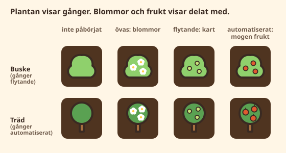

# Plan: delat med i Trädgården

Trädgården tränar i dag bara multiplikation. Division hänger tätt ihop med den,
men att ett barn kan 3 × 7 betyder inte att det säkert kan 21 ÷ 3. Barn och
vuxna löser ofta division genom att tänka på multiplikationen, och det går
långsammare. Därför tränas och mäts delat med för sig, i samma trädgård och med
samma familjer som gånger.

Planen följer arbetssättet från Bäcken: grafen och familjerna styr, en
förståelsedel kommer före faktaträningen, och bemästring mäts med en separat
koll.

## Beslut

1. **Delat med ingår i Trädgården**, i samma innehållspaket som gånger.
2. **En familj öppnar när den sitter flytande.** Familjen {3, 7, 21} öppnar
   21 ÷ 3 och 21 ÷ 7 samtidigt, när både 3 × 7 och 7 × 3 är minst flytande
   (buskar). Inte automatiserat, som tar veckor och som vissa barn aldrig når på
   knappsatsen. Inte hela tabeller, som är för grovt.
3. **Förståelsen kommer först.** Delen ”Dela lika” öppnar när den första
   familjen sitter, och den första divisionsfaktan kommer först när ”Dela lika”
   sitter.
4. **Det som öppnats stängs aldrig.** Tappar 3 × 7 ett steg fortsätter 21 ÷ 3
   ändå.
5. **Delat med skrivs med bråkstreck som standard,** 21 över 3, som i många
   svenska läroböcker. En vuxen kan ändra till `÷` eller `/` i föräldravyn. Se
   [Hur delat med skrivs](#hur-delat-med-skrivs).

## Innehåll

### Fakta och familjer

Rutan i rad *a*, kolumn *b* rymmer i dag *a × b*. Den får också divisionen
*ab ÷ b = a*: ruta 3 × 7 får 21 ÷ 7 = 3, och ruta 7 × 3 får 21 ÷ 3 = 7. Det blir
100 multiplikationsfakta och 100 divisionsfakta, och varje familj ligger i sina
två speglade rutor, som i dag. Kvadrattalen (7 × 7) har en ruta och en division
(49 ÷ 7).

Id:n blir `21/3` (21 delat med 3), bredvid dagens `3x7`. Varje division har
`requires: ['3x7', '7x3']`, alltså familjens båda multiplikationer.

### Delar och graf

Delat med följer samma ordning som gånger. Varje familj hör till den första
tabell den ingår i, som för gånger: 21 ÷ 3 och 21 ÷ 7 hör till ”Dela med 3”.

| Ordning | Del | Öppnar efter |
|---|---|---|
| 1 | Dela lika (förståelse) | att den första familjen sitter |
| 2 | Dela med 10 | Dela lika |
| 3 | Dela med 2 | Dela med 10 |
| … | … i samma ordning som gånger | |
| 11 | Dela med 7 och 8 | Dela med 6 |

Delarna öppnar efter varandra som i dag, men inom en öppen del kommer en
division in först när familjens båda multiplikationer sitter (`requires`). Ett
barn som kan ×2 men inte ×4 får alltså 16 ÷ 2 men inte 16 ÷ 4 förrän 4 × 4 sitter.

Division med 0 finns inte. Delat med 1 (7 ÷ 1) och med sig själv (7 ÷ 7) finns
med, eftersom de är begrepp och inte bara fakta.

### Dela lika (förståelse)

Som Vågen vid Bäcken: en egen del som bedöms på rätt svar på olika dagar och i
olika form, utan tidsgräns. Omkring 16 uppgifter med bild och flerval, av två
sorter som båda behövs:

- **Delning:** ”12 jordgubbar delas lika i 3 korgar. Hur många i varje?”
- **Innehållsdivision:** ”12 jordgubbar, 4 i varje korg. Hur många korgar?”

Barn möter oftast bara den första sorten. Bilderna är trädgårdens egna: bär,
korgar och rader i odlingslådan.

### Hur delat med skrivs

Delat med visas med bråkstreck som standard: täljaren över strecket och nämnaren
under, med `= __` bredvid. Planen skriver `21 ÷ 3` för att det ryms på en rad,
men det betyder bråkstreck.

- **Inställning per barn** i föräldravyn: ”Skriv delat med som: bråkstreck
  (standard) · ÷ · /”. Den följer det barnet möter i skolan.
- **Samma tecken överallt** där barnet ser delat med: frågan, introduktionen,
  hjälpkortet, räknestigen och kollen. Föräldravyn använder samma tecken, så att
  vuxna ser det barnet ser.
- **Uppläsning och skärmläsare** säger alltid ”21 delat med 3”, oavsett tecken.
- **Formatet med saknad faktor** (`3 × __ = 21`) och svaren på sifferknappsatsen
  påverkas inte.
- **Bråkstrecket tar två rader.** Frågekortet, hjälpkortet och räknestigen
  ritas om för det. Skärmbilder vid 320 px och liggande telefon visar att det
  ryms.
- **Längre fram:** när bråken kommer har barnet redan läst bråkstrecket som
  ”delat med”. Det stämmer matematiskt (5 över 6 är 5 delat med 6) och är en
  bra grund för bråk.
- **Lagring och flytt:** inställningen sparas i profilen (`divisionSign:
  'fraction' | 'obelus' | 'slash'`) och följer med i säkerhetskopian och i
  QR-koden (`MD1:`).

### Format

Som vid Bäcken visas en ny division i standardform de första två gångerna. Sedan
blandas formerna:

| Form | Exempel | Medan den övas | När den sitter |
|---|---|---|---|
| standard | `21 ÷ 3 = __` | 60 % | 80 % |
| saknad faktor | `__ × 3 = 21` | 25 % | 10 % |
| omvänd | `__ = 21 ÷ 3` | 15 % | 10 % |

Den saknade faktorn är bron mellan räknesätten. Den står i divisionens egen
ruta: 21 ÷ 3 = 7 bor i rutan 7 × 3, så luckan är sjuan. Alla former räknas som
bevis. När divisionen sitter visas den mest i standardform, så att det som
avgör om den är automatiserad mest är snabba svar i den formen. Gånger och
”Dela lika” har bara en form.

### Ny fakta

Samma rektangel som när barnet lärde sig 3 × 7, nu uppdelad: 21 prickar i
3 rader, hur många i varje? Sedan samma 21 i 7 rader. Familjen syns som en och
samma bild åt två håll. Därefter svarar barnet själv (”Nu du!”).

### Räknestigar

| Strategi | Exempel |
|---|---|
| räkna grupper från 2, 5 eller 10 | 5 × 6 = 30 → 30 + 6 + 6 = 42 → 42 ÷ 6 = 7 |
| ta bort grupper från 10 | 10 × 6 = 60 → 60 − 6 = 54 → 54 ÷ 6 = 9 |
| hälften (÷2) | hälften av 16 = 8 → 16 ÷ 2 = 8 |
| via tio (÷5) | 40 ÷ 10 = 4 → 4 + 4 = 8 → 40 ÷ 5 = 8 |

Stegen bygger bara på sådant barnet redan kan, och ingen uppgift visar svaret i
förväg. Därför börjar stigen aldrig i divisionens egen gångerfakta (7 × 6 för
42 ÷ 6). Där det första steget skulle avslöja svaret finns ingen stig: ÷1, ÷10
och kvoterna 1, 2, 5 och 10.

### Felsvar

Typiska förväxlingar som får en vänlig förklaring i hjälpkortet:

- svarar med divisorn (21 ÷ 3 = 3)
- grannfakta i samma tabell (21 ÷ 3 = 6 eller 8)
- multiplicerar i stället (21 ÷ 3 = 63)
- subtraherar (21 ÷ 3 = 18)

## Visualisering

**Plantan visar gånger, blommor och frukt visar delat med.** Samma tre kanaler
som i dag, som aldrig blandas:

| Begrepp | Uttrycks bara genom | Värden |
|---|---|---|
| Tillgänglighet | rutans bakgrund | äng · grävd jord (som i dag) |
| Kunskap, gånger | växten | frö · planta · buske · träd (som i dag) |
| Kunskap, delat med | blommor och frukt på busken eller trädet | inga · blommor (övas) · kart (flytande) · mogen frukt (automatiserat) |
| Hela tabeller | lådans kant och kullen | solros för gånger · skördekorg vid solrosen för delat med |

- **Formerna skiljer sig, inte bara färgerna:** vita blommor med gul mitt, små
  ljusgröna kart, större röda bär och äpplen med skaft. Det går att läsa även i
  de minsta rutorna på telefon.
- **Frukt växer bara på buske och träd.** Sjunker gångerfaktan till planta
  väntar frukten tills plantan har vuxit igen. Divisionens status ändras inte.
- **Det är verklig tillväxt:** blomma blir kart blir frukt. Delat med känns som
  nästa steg i trädgården, inte som en ny lista.
- **Kartan i dalen:** odlingslådan visar samma plantor med blommor och frukt.
- **Hela tabeller:** när hela tabellens delat med sitter får tabellens solros en
  skördekorg vid foten, och siffran på lådans kant får samma korg.

### Barn som redan spelar

Buskar har i dag alltid röda bär och träd gula blommor, bara som dekoration.
Med planen blir de gröna tills delat med övas. För barn som redan har buskar ser
det ut som om bären försvinner. Därför visas en gång en nyhet i trädgården:
”Nu kan dina buskar och träd få blommor och frukt! Dela lika med frukten, så
mognar den.” Det gör ändringen till något att se fram emot.

## Passet och resten av Trädgården

- **Dagens pass** blandar gånger och delat med som i dag: nya fakta en i taget
  bland många kända, i grafens ordning.
- **Öva en tabell** tar med tabellens divisioner när de är öppna.
- **Slå rekord och Mot en vän** förblir gånger tills vidare.
- **Startkollen** fortsätter efter gånger med delat med, men bara för familjer
  som kollen just har placerat som flytande. Den kan bara flytta fram barnet.
- **Trädgårdens koll:** som Bäckens. Omkring 12 uppgifter efter samma mall
  varje gång, utan anpassning: gånger, delat med i standardform och med saknad
  faktor, och ”Dela lika” med bild. Den kommer ungefär var sjunde speldag i
  trädgården, och resultaten visas bara i föräldravyn.
- **Föräldravyn:** en värmekarta för gånger och en för delat med (två kartor
  är lättare att läsa än delade rutor), svåra just nu och förväxlingar för
  båda, ”Dela lika” och kollens resultat.

## Teknisk design

- **Motorn:** `Item.requires?: ItemId[]`. En fakta introduceras bara när alla
  fakta den kräver är minst flytande. Har den väl introducerats stannar den.
  Motorn kan redan utesluta fakta ur ett pass (`excludedItemIds`), så ändringen
  är liten. Upplåsningen av delar räknar som i dag.
- **Innehållspaketet** `src/content/multiplication` får version 2 med
  divisionerna och ”Dela lika”. De 100 multiplikationerna behåller sina id:n och
  sin ordning först i listan.
- **Lagring och flytt:**
  - Sparade framsteg läses som i dag, eftersom tillstånd lagras per id.
    Divisionerna börjar som nya.
  - QR-koder från Gångerträdgården (`GT1:`) och `MD1:`-block med version 1 har
    100 nivåer. De läses in på de första 100 fakta, alltså multiplikationerna.
  - Säkerhetskopior läses som i dag.
- **Grafik:** blommor, kart och frukt ritas som egna lager ovanpå plantan
  (`plant.ts`), inte som nya plantor, så att tillväxtstegen för gånger är
  oförändrade.
- **Simulering:** den simulerade eleven får division som hämtas långsammare och
  ofta går via multiplikationen. Simuleringen ska visa hur lång tid det tar från
  flytande gånger till flytande delat med, och att takten håller sig runt
  80–90 % rätt.

## Faser

| Fas | Innehåll |
|---|---|
| G1. Motor och paket **(klar)** | `requires` i motorn, paketversion 2 med fakta, delar och graf, läsning av gamla QR-koder och säkerhetskopior, simulering. Inget ändras för barnen än: delat med ligger bakom `createMultiplicationPack({ division: true })`. |
| G2. Innehåll **(klar)** | ”Dela lika”, format, räknestigar, felsvar och förklaringar, bråkstreck i frågan och inställningen för tecknet. |
| G3. Trädgården | Blommor, kart och frukt, skördekorgen, introduktionen med delad rektangel, nyheten för barn som redan spelar, kartan i dalen. |
| G4. Runtomkring | Öva en tabell, startkollen, Trädgårdens koll och föräldravyn. |
| G5. Verifiering | e2e, skärmbilder vid 320 och 360 px, liggande telefon och surfplatta, dokumentation. |

## Fynd från G1

- **Delarna vävs ihop.** Nya fakta introduceras i delarnas ordning. Med
  divisionsdelarna sist hade all multiplikation kommit före den första
  divisionen. Därför ligger varje divisionsdel direkt efter sin tabell: ×10,
  Dela lika, Dela med 10, ×2, Dela med 2 och så vidare. Tabellerna öppnar efter
  tabellen före dem, och divisionsdelarna efter divisionsdelen före dem.
- **Simulering** (`tests/simulation/division.test.ts`, 26 veckor, sex dagar i
  veckan): en genomsnittlig elev har 90–91 av 100 divisioner som sitter och
  94–98 av 100 multiplikationer, mot 100 utan delat med. Andelen rätt ligger på
  84–85 %. En svag elev har påbörjat 49 divisioner och har 22 som sitter.
  Siffrorna är antaganden att pröva i piloten.

## Fynd från G2

- **Tecknet ritas, texten står kvar.** Alla uppgifter skrivs som `21 ÷ 3`.
  Skärmen ritar dem med barnets tecken (`mathNodes` i
  `src/shell/divisionSign.ts`), i frågan, i räknestigen och i
  förklaringarna. Uppläsningen säger ”delat med” oavsett tecken.
- **Bråkstrecket** ligger i höjd med likhetstecknet. En fråga med bråk har
  något mindre siffror, så att kortet behåller sin höjd.
- **Inställningen** syns i föräldravyn under Trädgården först när paketet har
  delat med (G3).

## Avgjorda frågor

1. **Tecknet:** bråkstreck som standard, `÷` eller `/` som inställning.
2. **Bären:** buskar och träd blir gröna tills delat med övas. Barn som redan
   spelar får en gång nyheten ”Nu kan dina buskar och träd få blommor och frukt!”.
3. **Slå rekord och Mot en vän** förblir gånger tills vidare. Delat med kan bli
   ett eget val där efter piloten.
