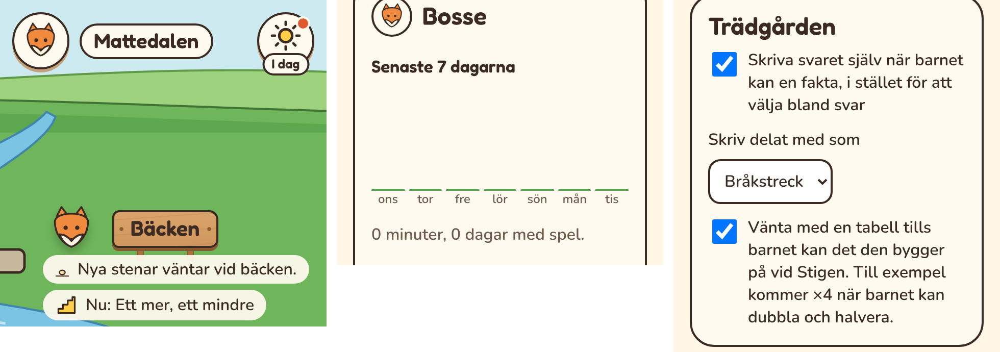
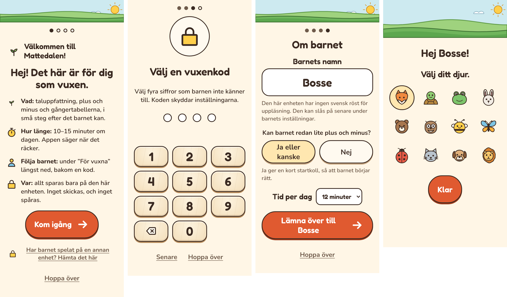
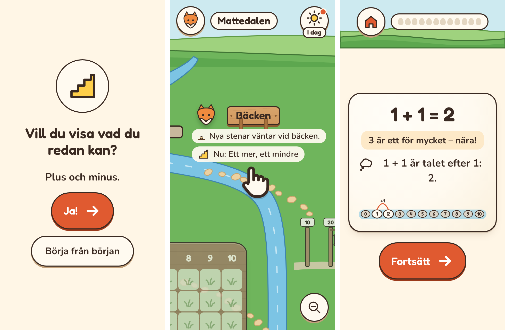

# Plan: enklare att förstå (E)

Appen ska vara lättare att förstå, för barn och för vuxna. Planen bygger på två
granskningar i oktober 2026: en genomgång av appen i telefonstorlek, som nytt
barn och som förälder, och en granskning av koden av en annan AI. Båda kom fram
till samma sak. Grunden och bildspråket ska vara kvar. Det som behövs är att det
blir tydligare vad man ska göra, hur man hittar och vad framstegen betyder.

## Faser

| Fas | Innehåll | Storlek |
|---|---|---|
| E1. Snabba rättelser **(klar)** | Diagrammet visar 7 dagar, ”I dag” får text, ”Passlängd” blir ”Tid per dag”, och inställningarna får enklare ord. | Liten |
| E2. Första starten för den vuxna **(klar)** | En kort introduktion som går att hoppa över: vad appen tränar, tid per dag, uppläsning, var ”För vuxna” finns och var datan sparas. Den vuxna väljer startkollen. Sedan ”Lämna över till barnet”. | Mellan |
| E3. Mindre läsning för barnet **(klar)** | Högtalarknapp på hjälpkorten och första skärmen, kortare hjälptext, en hand som visar draget på kartan, och skylten för dagens plats som rör sig. | Mellan |
| E4. Förklaringar vid behov | ”Vad betyder växterna?” (och stenarna och lyktorna) med bilder, vad ”sitter” betyder, en mening per barn och ”Så kan du hjälpa till”, säkerhetskopian efter vad man vill göra, och en påminnelse varje månad. | Mellan |

E4 planeras i detalj när E3 är provad. Varje fas kommer först i testversionen
([PLAN-TESTVERSION](PLAN-TESTVERSION.md)) och släpps när den är provad.

## E1. Snabba rättelser

Små ändringar som inte ändrar hur appen fungerar, bara hur den säger saker.

### 1. Diagrammet: senaste 7 dagarna

- **I dag:** rubriken säger ”Den här veckan”, men staplarna visar 14 dagar, och
  texten under räknar 7. Det är ett fel (`src/shell/screens/parent/parent.ts`).
- **Nu:** rubriken blir ”Senaste 7 dagarna”, och diagrammet visar de 7 dagarna.
- **Dagarna** står som veckodagar (”mån”, ”tis”), med i dag sist. Det är lättare
  att läsa än datum.
- **Texten under** blir kortare, eftersom rubriken redan säger vilka dagar det
  gäller: ”38 minuter, 4 dagar med spel.”

### 2. ”I dag” med text

- **I dag:** solen i hörnet av kartan har ingen synlig text. Den heter ”Det här
  kan du göra i dag” bara för skärmläsare. En sjuåring vet inte att solen är en
  knapp.
- **Nu:** ordet ”I dag” står under solen, som namnet under en app på hemskärmen.
  Knappen blir inte bredare, så raden längst upp ryms också på 320 px.
- **Pricken** finns kvar när något återstår i dag.
- **När dagen är klar** står det fortfarande ”I dag”. Rutan som öppnas säger
  redan vad som vilar. Inga poäng och ingen svit av dagar.

### 3. ”Passlängd” blir ”Tid per dag”

- **I dag:** inställningen styr hela dagens tid, som delas mellan högst två
  platser. Ordet ”Passlängd” låter som ett enda pass.
- **Nu:** ”Tid per dag”, med texten: ”Hur länge barnet övar per dag, allt
  tillsammans. Appen delar tiden mellan platserna efter vad som behöver
  repeteras.”
- **Samma ord överallt:** raden ”Barnets inställningar” i översikten,
  piloten och dokumenten.

### 4. Enklare ord i inställningarna

| I dag | Nu |
|---|---|
| Fritt svar med sifferknappar när en fakta sitter (annars bara flerval) | Skriva svaret själv när barnet kan en fakta, i stället för att välja bland svar |
| Tabellerna väntar på det de bygger på vid stigen | Vänta med en tabell tills barnet kan det den bygger på vid Stigen. Till exempel väntar ×4 på att dubbla och halvera. |
| Läs upp frågorna och dalens platser (svenska) | Läs upp frågorna och platserna med en svensk röst på enheten |
| Ge mer tid: ”En buske kräver då svar under … sekunder i stället för …” | Först i vardagsspråk: ”För ett barn som svarar rätt men långsamt. Växterna växer då också med lite längre svarstid.” Sekunderna kommer efter. |
| Att göra: ”Webbläsaren kan radera barnens framsteg om utrymmet tar slut.” och knappen ”Be om beständig lagring” | ”Webbläsaren kan rensa sparad data när enheten får ont om plats. Be den att behålla barnens framsteg.” och knappen ”Behåll framstegen” |

Exemplet för tabellerna hämtas ur samma lista som appen använder, så att det
alltid stämmer.

### Nytt i appen

En post: ”Enklare ord för vuxna”. Diagrammet visar senaste veckan, solen heter
”I dag”, och ”Passlängd” heter ”Tid per dag”.

### Tester och kontroll

- **E2e:** diagrammet har 7 staplar med veckodagar, ”I dag” syns under solen,
  ”Tid per dag” sparas, och de nya texterna finns. Befintliga tester som letar
  efter ”Passlängd” eller ”Det här kan du göra i dag” uppdateras.
- **Skärmbilder** i 320 och 360 px, och på surfplatta: kartans överkant,
  översikten och barnets inställningar. Inget får sticka ut åt sidan.
- **Skärmläsaren:** solen heter ”I dag. Det här kan du göra i dag” och diagrammet
  läser upp veckodag och minuter.

### Beslut för E1 (tagna)

1. **”I dag” på solen** (beslutat), inte i en bredare knapp. En bredare knapp
   tränger raden längst upp på 320 px.
2. **Veckodagar** under staplarna (beslutat).
3. **”Tid per dag”** (beslutat), inte ”Dagens övningstid”.

### Fallgropar i E1

- **Ordet ”sitter”** står kvar i E1. Vad det betyder förklaras i E4, så att
  förklaringen stämmer med motorns regler.
- **Testerna** letar efter knappar och fält med namn. Namnbytena gör att flera
  e2e-tester måste ändras i samma ändring.
- **Nyheten** kommer först i testversionen. Den vanliga appen får den när E1
  släpps.

## Fynd från E1

*Telefon, 320 px. Till vänster ”I dag” på solen i kartans hörn. I mitten
diagrammet med de senaste 7 dagarna. Till höger trädgårdens inställningar med
de nya orden.*

- **Diagrammet** visar 7 staplar med veckodagar, i dag sist. Skärmläsaren läser
  veckodag, datum och minuter.
- **”I dag”** står på en liten skylt över solens nederkant, inte under den.
  Kartans pilar börjar 84 px ned, och en text under solen hade krockat med dem.
  Rutan som öppnas har flyttats ned lite, så att skylten syns.
- **”Tid per dag”** står i barnets inställningar, i raden i översikten, i
  piloten och i README.
- **Lagringen** heter ”Behåll framstegen” både i ”Att göra” och under ”Den här
  enheten”, med samma förklaring.
- **Tabellerna:** exemplet ”kommer ×4 när barnet kan dubbla och halvera” hämtas
  ur samma lista som det barnet ser i trädgården.
- **Inget sticker ut åt sidan** i 320 och 360 px, eller på surfplatta.
- **Tester:** e2e för diagrammet, ”I dag”, ”Tid per dag”, exemplet för
  tabellerna och de nya texterna. Ett enhetstest för veckodagarna.

## E2. Första starten för den vuxna

En kort start för den vuxna, första gången appen öppnas på en enhet. Den går att
hoppa över. Sedan lämnar den vuxna över till barnet.

### Varför

- **Den vuxna möts aldrig av appen.** Första skärmen frågar ”Vad heter du?” och
  är till för barnet. ”För vuxna” är en liten länk längst ned.
- **Barnet får frågor som är till för den vuxna.** ”Kan du redan lite plus och
  minus?” är svår att svara på om man är sex år. Ett barn som inte kan läsa
  väljer en knapp på måfå.
- **Uppläsningen är avstängd från början** och finns bara under barnets
  inställningar. Ett barn som inte läser själv får läsa allt.
- **Vuxenkoden, tiden per dag och hemskärmen** hittar man bara om man letar.
- **Granskningen frågade samma sak:** vad tränar appen, hur länge, var följer
  jag barnet, och var sparas framstegen.

### När

- **Bara på en enhet utan barn.** En enhet som redan har barn, också barn som
  följde med från Gångerträdgården, får ingen start för vuxna.
- **En gång.** Starten räknas som gjord när den är klar eller överhoppad. Det
  sparas i en inställning på enheten.
- **”Ny spelare” senare** fungerar som i dag: barnet skriver sitt namn och får
  frågan om startkollen. Se beslut 4.

### Stegen

Högst fem skärmar, med prickar som visar var man är. Varje skärm har ”Hoppa
över”, som går direkt till barnets skärm som i dag.

1. **Välkommen.** Rubrik: ”Hej! Det här är för dig som vuxen.” Fyra korta rader:
   - **Vad:** taluppfattning, plus och minus och tabellerna, i små steg efter det
     barnet kan.
   - **Hur länge:** 10–15 minuter om dagen. Appen säger när det räcker.
   - **Följa barnet:** under ”För vuxna” längst ned, bakom en kod.
   - **Var:** allt sparas bara på den här enheten. Inget skickas, och inget
     spåras.

   Knappar: ”Kom igång” och ”Hoppa över”. Här står också ”Har barnet spelat på
   en annan enhet? Hämta det här”, som i dag finns på barnets skärm.
2. **Hemskärmen**, bara om appen inte redan är tillagd. Samma guide som i dag,
   med knappen ”Installera appen” där det går. På iPhone och iPad står först:
   ”Lägg till appen på hemskärmen först och börja där. Appen på hemskärmen har
   egen lagring, så det du gör här i Safari följer inte med.” Knappar: ”Klar”
   och ”Fortsätt här”.
3. **Vuxenkoden.** ”Välj fyra siffror som barnen inte känner till. Koden skyddar
   inställningarna.” Samma knappsats som i dag, två gånger. ”Senare” hoppar
   över; då väljs koden första gången ”För vuxna” öppnas, som i dag.
4. **Om barnet.** På en skärm:
   - **Barnets namn** (fältet ”Namn”).
   - **”Läser barnet själv?”** ”Ja” eller ”Inte än”. ”Inte än” slår på
     uppläsningen. Finns ingen svensk röst på enheten står det i stället vad
     som saknas, med samma text som i inställningarna, och frågan visas inte.
   - **”Kan barnet redan lite plus och minus?”** ”Ja eller kanske” ger
     startkollen. ”Nej” börjar från början. Barnet får då inte frågan själv.
   - **Tid per dag**, 10–15 minuter, med 12 förvalt.

   Knappen: ”Lämna över till Bosse”.
5. **Lämna över.** En skärm för barnet: ”Hej Bosse! Välj ditt djur.” Djuren som
   i dag, och knappen ”Klar”. Sedan bäcken: startkollen direkt om den vuxna
   valde den, annars första passet.

### Det som sparas

- **På enheten:** att starten är gjord, och vuxenkoden om den valdes.
- **För barnet:** namnet, djuret, uppläsningen, tiden per dag och att frågan om
  startkollen är besvarad. Samma inställningar som finns i dag. Inget nytt om
  barnet.

### ”Så fungerar Mattedalen” i ”För vuxna”

Samma fyra rader som i steg 1 blir en sida i ”För vuxna”, efter ”Tyck till”.
Familjer som redan har barn får läsa dem där. E4 bygger vidare på sidan med vad
växterna och ”sitter” betyder.

### Nytt i appen

En post: ”En start för vuxna”. Nya enheter börjar med en kort start för den
vuxna, och ”Så fungerar Mattedalen” finns i ”För vuxna”.

### Tester och kontroll

- **E2e:**
  - en ny enhet visar starten, och en enhet med barn gör det inte;
  - ”Hoppa över” på varje steg ger barnets skärm som i dag;
  - hela vägen sparar namn, djur, uppläsning, tid per dag och vuxenkod, och
    startkollen kommer direkt när den valdes, utan frågan till barnet;
  - hemskärmssteget saknas när appen redan är tillagd;
  - iPhone-texten visas för en iPhone;
  - ”Hämta det här” finns kvar och fungerar;
  - starten kommer bara en gång, också efter en omladdning mitt i;
  - testversionen visar sin rad även här.
- **Hjälpfunktionen för testerna:** 27 e2e-filer skapar barn med
  `createProfile`. Den hoppar över starten, så att de övriga testerna inte
  ändras.
- **Skärmbilder** i 320 och 360 px och på surfplatta, för varje steg. Inget får
  sticka ut åt sidan, och knapparna ska synas utan att man scrollar på 320 × 640.

### Beslut för E2 (tagna)

Förslagen nedan gäller.

1. **Den vuxna skriver namnet, barnet väljer djur** (förslag). Annars gör barnet
   båda som i dag, och den vuxnas frågor kommer efteråt.
2. **”Läser barnet själv?”** (förslag) i stället för en ruta ”Läs upp”. Frågan
   handlar om barnet, inte om tekniken.
3. **Hemskärmen före barnet** (förslag), med ”Fortsätt här” för den som vill.
   På iPhone och iPad är det viktigt, se fallgroparna.
4. **”Ny spelare” som i dag** (förslag) i E2. Ett syskon som läggs till senare
   får frågan om startkollen själv. En senare fas kan låta den vuxna svara även
   där, bakom koden.
5. **Sidan ”Så fungerar Mattedalen”** i ”För vuxna” (förslag), så att familjer som
   redan har barn också får texten.

### Fallgropar i E2

- **iPhone och iPad:** appen på hemskärmen har egen lagring, skild från Safari.
  Ett barn som läggs till i Safari finns inte i appen på hemskärmen. Därför
  kommer hemskärmen före barnet, och texten säger varför.
- **En vuxen som hoppar över** ska inte fastna. Barnets skärm, frågan om
  startkollen och vuxenkoden fungerar som i dag.
- **Ett barn som hittar starten** kan trycka sig igenom. Det är ofarligt: allt
  går att ändra i ”För vuxna”, och vuxenkoden kan väljas igen.
- **Testversionen** har egna barn, så den visar starten för vuxna första gången
  den öppnas på en enhet. Det är rätt, och ett bra sätt att prova starten.
- **Barnets skärm i dag** har ”Vad heter du?” och djuren. Med beslut 1 delas den
  i två: namnet hos den vuxna och djuret hos barnet. ”Ny spelare” behåller båda.

## Fynd från E2

*Telefon, 320 px. Från vänster: välkommen med de fyra raderna, vuxenkoden som
ett steg, om barnet och barnets tur att välja djur.*

- **Starten** (`src/shell/screens/intro.ts`) kommer bara på en enhet utan barn,
  en gång. Den räknas som gjord när den är klar eller överhoppad.
- **Stegen** är fyra, eller tre när appen redan ligger på hemskärmen. Prickarna
  överst visar var man är, också för skärmläsare (”Steg 2 av 4”).
- **Vuxenkoden** är samma knappsats som förut, med ”Senare” och ”Hoppa över”
  under. ”Senare” betyder att koden väljs första gången ”För vuxna” öppnas.
- **Om barnet:** knappen ”Lämna över till Bosse” går att trycka först när namnet
  finns och frågan om startkollen är besvarad, och frågan om läsning när
  enheten har en svensk röst. Utan röst säger sidan det i en rad.
- **Startkollen:** platserna har fått `firstStart`. Bäcken gör startkollen
  direkt eller börjar från början, och barnet får inte frågan.
- **Barnets skärm** och ”Ny spelare” är som förut. Djuren och starten av ett nytt
  barn delas nu mellan barnets skärm och starten för vuxna.
- **”Så fungerar Mattedalen”** är en sida i ”För vuxna” med samma fyra rader.
- **På 320 × 640** syns huvudknappen i varje steg utan att man scrollar. Steget
  ”Om barnet” blev tätare för det: svarsknapparna står bredvid varandra, och
  texten om rösten är kortare.
- **Tester:** `e2e/intro.spec.ts` med hela vägen, ”Nej”, ”Hoppa över” på varje
  steg, ”Senare”, appen på hemskärmen, iPhone-texten, med och utan svensk röst,
  ”Hämta det här” och sidan i ”För vuxna”. Hjälpfunktionen `createProfile`
  hoppar över starten, så de andra testerna är som förut.

## E3. Mindre läsning för barnet

Barnet ska klara appen utan att läsa mycket. Det blir mindre text på skärmen,
fler saker läses upp, och kartan visar själv vad man gör.

### Varför

- **Hjälpkortet vid fel svar** har fyra rader text: ”Du svarade 4. Så här kan du
  tänka:”, svaret, en mening om svaret (”4 är ett för mycket – nära!”) och
  tankesättet. En sexåring läser inte allt det mitt i ett pass.
- **Uppläsningen läser bara svaret** på hjälpkortet, inte meningen om svaret
  eller tankesättet. Ändskärmen och frågan om startkollen läses inte upp alls.
- **Frågan om startkollen** (”Kan du redan lite gånger?”) får barnet fortfarande
  vid Stigen och i trädgården, och vid bäcken för ett syskon som läggs till med
  ”Ny spelare”.
- **Kartan** ska dras runt, och skylten är knappen. Det vet inte ett barn som är
  där första gången.
- **Barn som redan finns** har uppläsningen avstängd, om inte en vuxen har hittat
  den i inställningarna.

### Hur

#### 1. Hjälpkortet

- **Färre rader:**
  - ”Du svarade 4.” stryks när meningen om svaret redan nämner 4, som i ”4 är
    ett för mycket – nära!”. Annars står den kvar.
  - ”Så här kan du tänka:” blir en liten tankebubbla framför tankesättet, utan
    ord.
  - Kvar blir svaret, högst en mening om svaret, och tankesättet med sin bild.
- **Kortare tankesätt:** först mäts alla tankesätt och meningar i alla tre
  platserna. De längsta skrivs om när bilden redan visar samma sak. Ett
  enhetstest håller dem under en gräns som sätts efter mätningen.
- **Uppläsning av hela kortet:** svaret, meningen och tankesättet läses upp i
  den ordningen när kortet visas. En högtalarknapp på kortet läser upp det igen.

#### 2. Uppläsning där den saknas

Bara när uppläsningen är på och enheten har en svensk röst, som i dag.

- **Ändskärmen:** ”Bra jobbat! Bäcken vilar nu. Kom tillbaka i morgon!” och det
  som hände i passet.
- **Frågan om startkollen**, och skärmen efter startkollen.
- **Kortet ”Nytt: minus”** vid bäcken.
- **Platsens skärm:** vad barnet gör nu (”Nu: Ett mer, ett mindre”) och den stora
  knappen.
- Varje skärm som läser upp något har en högtalarknapp, så att barnet kan höra
  det igen.

#### 3. Frågan om startkollen till barnet

Den står kvar där ingen vuxen har svarat, men blir lättare för ett barn:
”Vill du visa vad du redan kan?” med knapparna ”Ja!” och ”Börja från början”.
Den långa förklaringen stryks, och frågan läses upp.

#### 4. Kartan visar draget

- **En hand** glider över kartan och visar draget, utan ord. Den kommer de första
  gångerna barnet är på kartan, tills barnet själv har dragit kartan, och högst
  tre gånger.
- **Bara när kartan är större än skärmen.** På en surfplatta som visar hela dalen
  behövs ingen hand.
- **Med minskade rörelser** (enhetens inställning) står handen stilla en stund
  med en pil, och försvinner sedan.

#### 5. Skylten för dagens plats

- **Skylten gungar lite** vid den plats som står först i ”I dag”, så att barnet
  ser vart det ska. Den slutar när barnet trycker eller drar på kartan.
- **Ingenting gungar** när dagen är klar.
- **Med minskade rörelser** får skylten en lugn gul kant i stället.

#### 6. Uppläsning för barn som redan finns

En rad i ”Att göra för dig”, en gång per barn, när enheten har en svensk röst och
uppläsningen är av: ”Läser Bosse själv? Appen kan läsa upp frågorna.” Knapparna
blir ”Slå på uppläsning” och ”Bosse läser själv”. Raden försvinner efter ett
val. Det kräver att en rad i ”Att göra” kan ha två knappar.

### Nytt i appen

En post: ”Mindre att läsa för barnen”, med de viktigaste ändringarna.

### Tester och kontroll

- **E2e:**
  - hjälpkortet har färre rader, och ”Du svarade” står bara när meningen inte
    redan nämner svaret;
  - med en svensk röst läses hela kortet upp, ändskärmen och frågan om
    startkollen också, och högtalarknapparna fungerar;
  - frågan om startkollen har de nya orden;
  - handen kommer på telefon men inte när hela dalen syns, och slutar när barnet
    har dragit kartan;
  - skylten gungar vid dagens plats och inte när dagen är klar;
  - med minskade rörelser gungar ingenting;
  - raden i ”Att göra” slår på uppläsningen och försvinner;
  - befintliga tester som läser hjälpkortets text uppdateras.
- **Enhetstest** för längden på tankesätten och meningarna.
- **Skärmbilder** i 320 och 360 px och på surfplatta: hjälpkortet före och efter,
  handen på kartan, och den gungande skylten. Inget får sticka ut åt sidan.

### Beslut för E3 (tagna)

Förslagen nedan gäller.

1. **”Du svarade 4.” stryks när meningen redan nämner 4** (förslag). Att barnet
   ser sitt eget svar är viktigt, och då står det fortfarande på kortet.
2. **Hela hjälpkortet läses upp direkt** (förslag), eller bara svaret direkt och
   resten med högtalarknappen.
3. **Handen högst tre gånger** (förslag), tills barnet har dragit kartan.
4. **Skylten gungar** (förslag). Ett alternativ är att djuret hoppar vid
   platsen.
5. **Raden om uppläsning i ”Att göra”** för barn som redan finns (förslag), eller
   ingen rad.

### Fallgropar i E3

- **Utan svensk röst** läses ingenting upp. Kortare text är därför det viktigaste
  i E3, inte uppläsningen.
- **Tal på iPhone** startar bara efter ett tryck. Hjälpkortet och ändskärmen
  kommer alltid efter ett tryck, så det fungerar.
- **Rörelser kan störa.** Handen och skylten rör sig bara på kartan, aldrig i ett
  pass, och följer enhetens inställning för minskade rörelser.
- **Tankesätten kommer från innehållet** i varje plats. Att korta dem kan ändra
  vad testerna förväntar sig. Det görs i samma ändring.
- **Uppläsning som pratar för mycket** blir tjatig. Det som läses upp är kortet
  som syns, inget mer, och det avbryts när barnet trycker vidare.

## Fynd från E3

*Telefon, 320 px. Från vänster: frågan om startkollen med de nya orden, kartan
med handen och den gungande skylten vid Bäcken, och hjälpkortet med färre rader
och en tankebubbla.*

- **Tankesätten var redan korta.** Mätningen räknade orden bredvid talen: högst
  8 vid bäcken och Stigen. I trädgården hade korgarna i ”Dela lika” 9 och 13 ord.
  De skrevs om till ”Dela ut en i taget: 3 i varje korg.” och ”Fyll korgar med 4
  i varje: 3 korgar.”. Ett enhetstest håller alla tankesätt på högst 8 ord.
- **Hjälpkortet:** ”Du svarade 3.” står bara när meningen om svaret inte redan
  börjar med 3. ”Så här kan du tänka:” är en tankebubbla, och orden finns kvar
  för skärmläsare.
- **Uppläsningen** läser svaret, meningen och tankesättet. Högtalarknappen i
  passets överkant läser upp kortet igen; kortet har ingen egen knapp, så att det
  inte blir två likadana. Uppläsningen tystnar när barnet trycker vidare.
- **Kortet ”Nytt: minus”** lästes redan upp, som alla introkort.
- **Platsernas sidor, ändskärmarna, frågan om startkollen och skärmen efter
  startkollen** har fått en högtalarknapp. Ändskärmarna och frågan läses upp
  direkt, eftersom de alltid kommer efter ett tryck. Platsernas sidor läses bara
  med knappen, så att de inte pratar varje gång barnet går dit.
- **Frågan om startkollen** heter ”Vill du visa vad du redan kan?” i alla tre
  platserna, med platsens bild och två ord om vad den gäller.
- **Handen** visas bara när kartan är större än skärmen. På surfplattan i testerna
  syns hela dalen, och där kommer ingen hand.
- **Skylten** gungar vid den plats som står först i ”I dag”, med en kort gungning
  ungefär var tredje sekund.
- **Raden i ”Att göra”** väntar inte på enhetens röster. Den ser bara de röster
  som redan är laddade, och annars kommer den nästa gång ”För vuxna” öppnas. En
  första version väntade en stund på rösterna; då hann sidan ritas om ovanpå
  nästa skärm, vilket ett test fångade. Svarade den vuxna
  på läsfrågan i starten för vuxna kommer raden aldrig.
- **Tester:** `e2e/reading.spec.ts` med raden i ”Att göra”, högtalaren vid
  bäcken, uppläsningen av hjälpkortet och frågan om startkollen, skylten, minskade
  rörelser och handen. `tests/game/strategyLength.test.ts` för längden.

