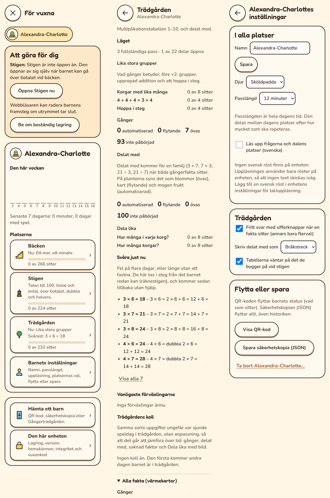
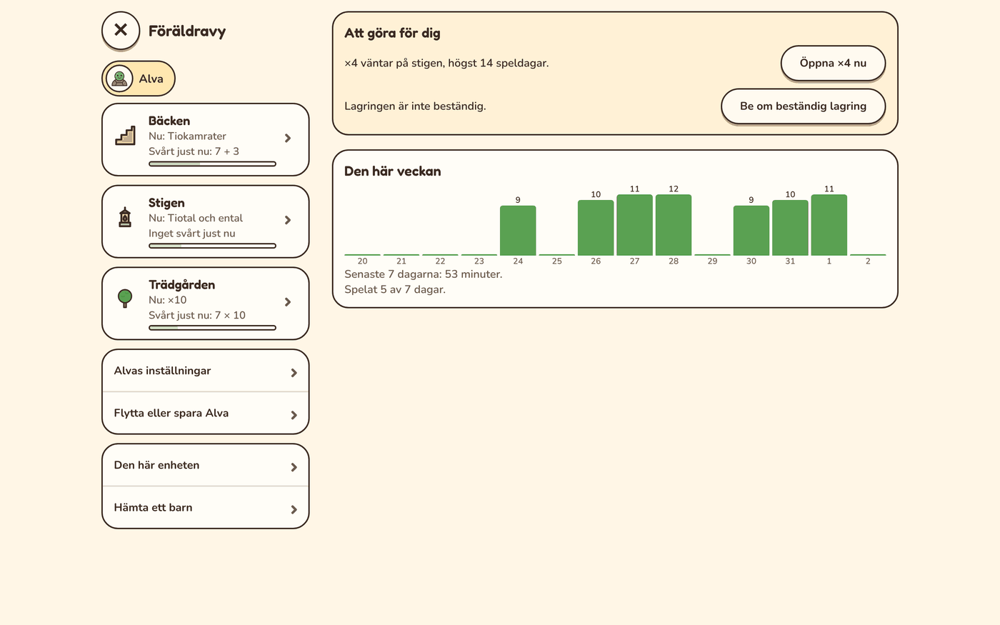

# Plan: en lättare föräldravy (F)

Föräldravyn blir en kort översikt med en rad per plats, och resten bakom en
tryckning. Det den vuxna behöver göra står överst. Inställningarna samlas på ett
ställe, och det som gäller enheten får en egen sida.

## Varför

- **Allt ligger på en sida.** På en telefon är föräldravyn i dag nästan
  10 000 px lång: barnets minuter och inställningar, tre platsdelar med sex till
  nio underrubriker och värmekartor var, att hämta barn, lagring, version,
  hemskärm, integritet och vuxenkod.
- **Det som kräver en vuxen syns inte.** En tabell som väntar på stigen, eller
  lagring som inte är beständig, ligger mitt i en lång sida.
- **Inställningarna är utspridda.** Passlängd och uppläsning står under barnet,
  fritt svar, hur delat med skrivs och väntan på stigen under trädgården, och
  att öppna Stigen under Stigen.
- **Föräldravyn växer** med varje plats och fas: loggexporten (R5) och fler
  platser.

## Skiss

Skissen är en attrapp av föräldravyns egna delar.

*Telefon, 360 px. Till vänster översikten: det som väntar på en vuxen, veckan och
en rad per plats. I mitten en plats: läget först, sedan det som är svårt och
kollen. Till höger barnets inställningar på ett ställe.*

*Dator: platserna och menyn till vänster, innehållet till höger.*

## Sidorna

1. **Översikt** (första sidan efter vuxenkoden)
   - Barnen överst, som i dag.
   - **Att göra för dig**, bara när det finns något. Till exempel en tabell
     som väntar på stigen, med knappen ”Öppna ×4 nu”, Stigen som kan öppnas,
     ett nytt kollresultat eller lagring som inte är beständig.
   - **Den här veckan:** minuterna per dag och hur många dagar barnet spelat.
   - **En rad per plats:** vad barnet är på nu, det som är svårast just nu
     och en stapel för hur mycket som sitter. Ett tryck öppnar platsen.
   - **Länkar:** barnets inställningar, flytta eller spara barnet, den här
     enheten och hämta ett barn.
2. **En plats** (Bäcken, Stigen, Trädgården), i samma ordning på alla platser
   - **Läget:** vad barnet är på, delarna och hur mycket som sitter.
   - **Svårt just nu**, högst fem med ”Visa alla”, och de vanligaste
     förväxlingarna.
   - **Kollen över tid.**
   - **Alla fakta (värmekartor)**, ihopfällt.
   - **Platsens inställningar och startkollen** sist.
3. **Barnets inställningar**: namn, djur, passlängd, uppläsning, fritt svar,
   hur delat med skrivs, väntan på stigen och att öppna en plats tidigare.
   Längst ner flytta, spara och ta bort.
4. **Den här enheten**: lagring, version och uppdatering, hemskärmen,
   integritet och vuxenkod.
5. **Hämta ett barn**: QR-kod, säkerhetskopia och Gångerträdgården.

## Regler

- **Varje sida får plats** på en telefon med lite rullning. Översikten ska
  synas utan att rulla långt.
- **Telefonens bakåtknapp** går ett steg bakåt, från platsen till översikten.
  Varje sida har en egen adress i appen.
- **Siffror är tillåtna här,** till skillnad från barnens sidor. Antal och
  andelar står i föräldravyn.
- **Samma ordning på alla platser,** så att en vuxen hittar samma sak på samma
  ställe.
- **En kryssruta och dess text står på samma rad.** I dag hamnar rutan ovanför
  texten.

## Vad som ändras i koden

- **`Place.parentSection`** delas i tre: `parentSummary` (raden i översikten
  och sakerna att göra), `parentPage` (platsens sida) och `parentSettings`
  (platsens del av barnets inställningar).
- **`shell/screens/parent/`** delas i en fil per sida: översikt, plats,
  inställningar, enheten och hämta.
- **Föräldravyns delar,** till exempel värmekartan, kollresultaten och listan
  över svåra fakta, används som i dag.
- **Testerna** för föräldravyn letar efter samma saker, men på rätt sida.

## Faser

| Fas | Innehåll |
|---|---|
| F1. Översikten och sidorna | Översikten, sidorna för plats, inställningar, enheten och hämta, bakåtknappen och delningen av `parentSection`. |
| F2. Att göra och raderna | Listan över det som väntar på en vuxen, raderna per plats och ”Svårt just nu” med ”Visa alla”. |
| F3. Verifiering | Skärmbilder i alla storlekar, testerna, dokumenten. |

Loggexporten i R5 läggs i den nya strukturen, under barnets ”Flytta eller
spara”.

## Beslut

Beslutat i oktober 2026, enligt förslagen:

1. Den heter **För vuxna**, som knappen på startsidan, eftersom också lärare kan
   använda den.
2. **Att göra** kan inte avfärdas. En sak försvinner när den är gjord.
