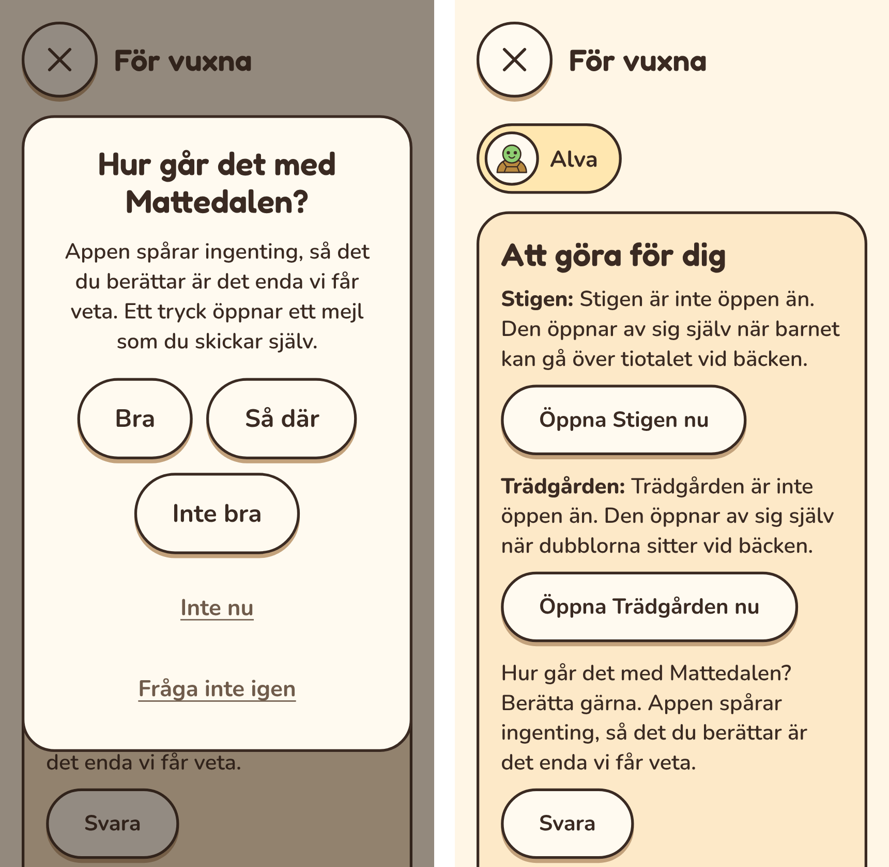

# Plan: appen frågar den vuxna hur det går (T)

En ruta i ”För vuxna” som ber den vuxna tycka till. Första gången efter fem
speldagar, sedan högst en gång per kvartal. Allt räknas på enheten, och inget
skickas av appen själv.

## Varför

- **Vi ser inte hur appen används.** Appen spårar ingenting, så det de vuxna
  berättar är det enda vi får veta. ”Tyck till” finns, men bara för den som letar
  upp sidan.
- **Efter fem speldagar** har barnet och den vuxna sett tillräckligt för att ha en
  åsikt, men inte så mycket att de har slutat bry sig.
- **En gång per kvartal** räcker för att höra hur det går över tid, utan att
  tjata.

## Hur

### När

- **Speldagar** räknas ur passen som redan sparas: dagar då något barn på
  enheten har spelat, alla barn tillsammans.
- **Första gången:** när enheten har fem speldagar.
- **Sedan:** tidigast 90 dagar efter förra frågan, och bara om enheten har minst
  fem nya speldagar sedan dess. En enhet som har slutat användas får ingen fråga.
- **Frågan går före ”Nytt i Mattedalen”** (beslutat). Ska båda visas på samma
  gång kommer frågan först, och ”Nytt i Mattedalen” direkt när den har stängts.
  Det händer när appen efter en uppdatering öppnar ”För vuxna” igen. Annars
  visas ”Nytt i Mattedalen” som förut över första skärmen, och frågan när ”För
  vuxna” öppnas.

### Var

- **När en vuxen öppnar ”För vuxna”,** efter vuxenkoden, visas rutan över
  översikten. Där vet vi att det är en vuxen. Ett barn möter aldrig rutan.
- **I ”Att göra för dig”** står samma fråga som en rad, tills den vuxna har
  svarat eller tackat nej. Om rutan trycks bort finns frågan alltså kvar.
- **Inte på ”Vem spelar?”** till att börja med (beslutat). Kommer det för få
  svar kan en liten rad där läggas till: ”Till den vuxna: vi vill gärna höra hur
  det går.”

### Rutan

- **Rubrik:** ”Hur går det med Mattedalen?”
- **Text:** en mening om varför: appen spårar ingenting, så det du berättar är det
  enda vi får veta.
- **Tre knappar för svaret:** ”Bra”, ”Så där” och ”Inte bra”. Varje knapp öppnar
  mejlet från ”Tyck till” i den vuxnas eget mejlprogram, med svaret redan
  ifyllt överst, följt av de vanliga frågorna. Ett tryck och sedan skicka.
- **”Inte nu”:** frågar igen om sju dagar, högst två gånger. Sedan väntar frågan
  till nästa kvartal.
- **”Fråga inte igen”:** frågan visas aldrig mer, varken som ruta eller som rad.
  ”Tyck till” finns kvar som förut.
- **Ett svar** räknas som när knappen trycks. Appen kan inte veta om mejlet
  skickades, och ska inte fråga igen förrän nästa kvartal.

### Det som sparas

En inställning på enheten: dagen för senaste frågan, hur många gånger ”Inte nu”
har tryckts, och om den vuxna har valt ”Fråga inte igen”. Inget om barnen, och
inget lämnar enheten.

### Nytt i appen

En post i `src/shell/news.ts` när rutan finns: ”Appen frågar ibland hur det går”.

## Faser

| Fas | Innehåll |
|---|---|
| T1. Frågan **(klar)** | Regeln för när, rutan, raden i ”Att göra”, mejlet med svaret, de tre valen och posten i ”Nytt i appen”. Enhetstester för regeln, e2e, skärmbilder och dokumenten. |

## Fallgropar

- **Ett barn som kan vuxenkoden** kan trycka bort rutan. Raden i ”Att göra” finns
  kvar tills den vuxna har svarat eller tackat nej.
- **Klockan:** dagarna räknas i enhetens kalender, som allt annat i appen. En
  enhet med fel datum kan få frågan för tidigt eller för sent. Det är ofarligt.
- **Flera barn på samma enhet** ger en fråga, inte en per barn. Frågan gäller hur
  appen fungerar i familjen.
- **E2e-tester** som öppnar ”För vuxna” efter många speldagar får en ruta i
  vägen. De behöver ett sätt att stänga den, eller data där frågan redan är
  besvarad.

## Fynd från T1

*Telefon, 320 px. Till vänster rutan när ”För vuxna” öppnas. Till höger raden i
”Att göra för dig” med knappen ”Svara”, som finns kvar om rutan stängs utan
val.*

- **Regeln** (`src/shell/ask.ts`) räknar speldagar ur passen för alla barn på
  enheten. Enhetstester visar fem dagar för första frågan, 90 dagar och fem nya
  speldagar för nästa, två ”Inte nu” med en vecka emellan och sedan ett kvartal,
  och att ”Fråga inte igen” gäller för alltid.
- **Svaren** är riktiga länkar till mejlet i ”Tyck till”, med ”Hur går det? Så
  där” överst. Appen öppnar inget själv; den vuxna trycker.
- **Stängs rutan utan val,** med Escape eller utanför, ändras ingenting, och
  raden i ”Att göra” står kvar. Efter ett val ritas sidan om, så att raden
  försvinner direkt.
- **Ordningen efter en uppdatering:** appen öppnar ”För vuxna” igen, frågar
  efter vuxenkoden, visar frågan och sedan ”Nytt i Mattedalen”. E2e-testet
  kontrollerar ordningen.
- **”Nytt i Mattedalen” räknas som sedd när den visas,** inte först efter
  ”Okej”. Testerna visade att rutan annars kunde komma igen om appen laddades
  om direkt efter ”Okej”.
- **En ny enhet räknas före Gångerträdgården.** Barn som följer med därifrån
  vid första starten gjorde att enheten såg ut som en gammal enhet, och rutan
  ”Nytt i Mattedalen” visades. Nu avgör appen om enheten är ny innan barnen
  hämtas.
- **”Nytt i appen”** har en post om frågan.
