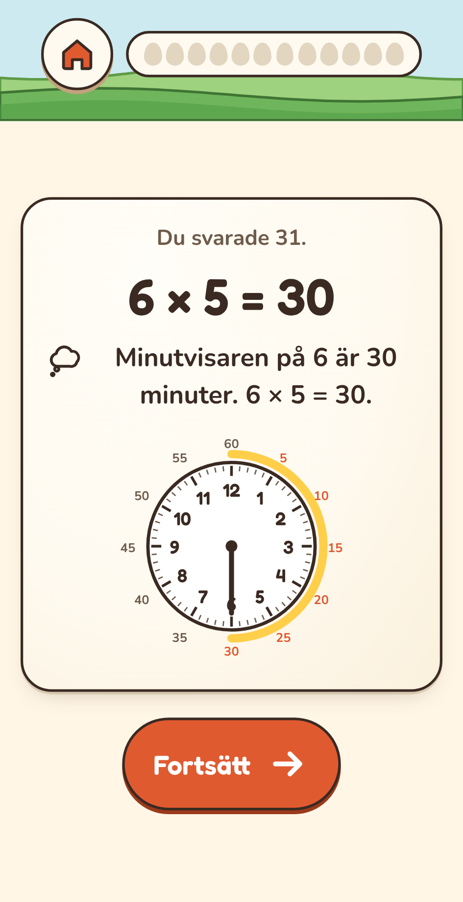
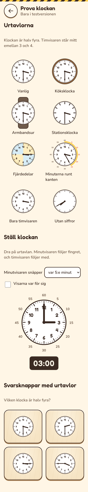
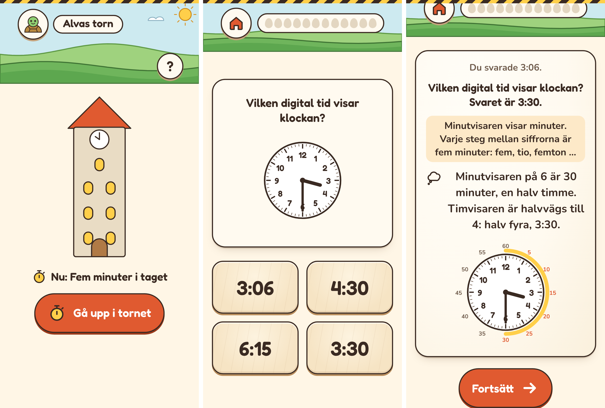
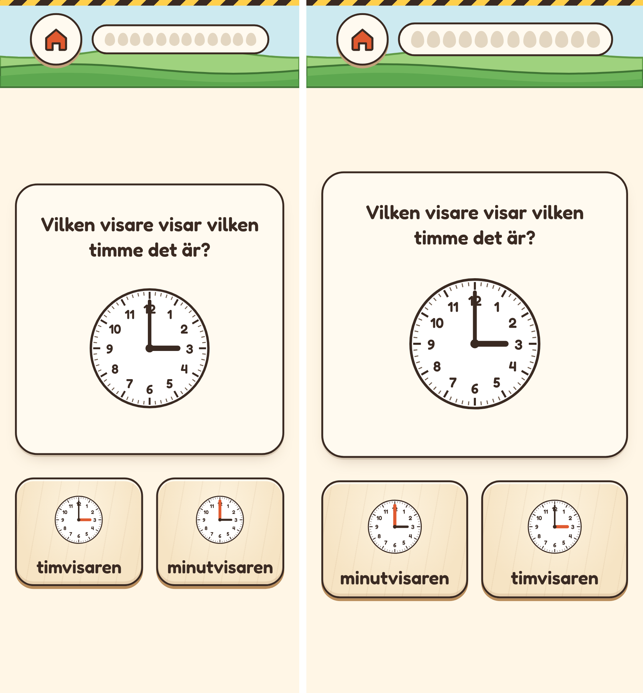
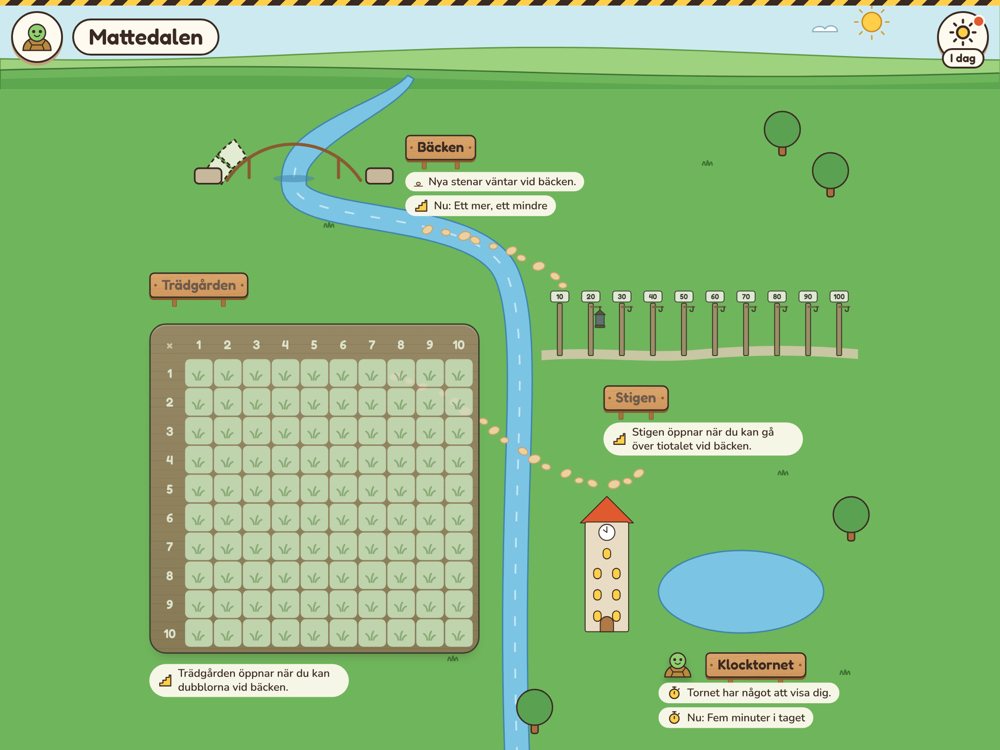
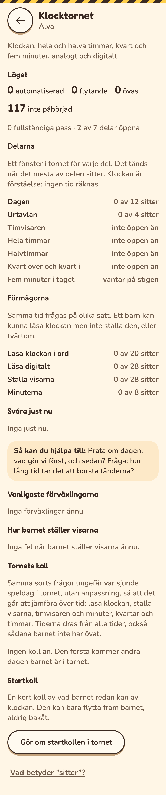

# Plan: klockan och fler stöd (ST och KL)

Två saker i en plan:
- **Barnet lär sig läsa klockan** i en ny plats, Klocktornet.
- **Trädgården får fler stöd för tabellerna:** klockan för femmans tabell,
  fingrarna för nians, hopp på tallinjen, mönster i tabellen och pengar.

Klockan hör till båda. Minutvisaren på 7 är 35 minuter, och det är 7 × 5.

Planen bygger på två underlag om hur barn lär sig klockan i F–åk 3
([KLOCKAN-UNDERLAG](KLOCKAN-UNDERLAG.md) och
[KLOCKAN-UNDERLAG-2](KLOCKAN-UNDERLAG-2.md)). Båda säger samma sak i grunden:
barnet ska inte bara lära sig vad klockan är, utan förstå vad som händer med
tiden.

Tornet ska ge barnet fyra förmågor:
1. **Känna igen:** läsa en tid.
2. **Förstå:** veta varför klockan visar den tiden.
3. **Använda:** räkna ut hur mycket tid som har gått eller är kvar.
4. **Överföra:** växla mellan urtavla, digital tid och ord, och läsa klockan
   hemma.

## Faser

| Fas | Innehåll | Storlek |
|---|---|---|
| ST1. Klockans tabell **(klar)** | Urtavlan med minutvisaren som bild för ×5 och ÷5, regeln för fler bilder i hjälpen, och inställningen ”Bilder i hjälpen”. | Mellan |
| KL1. Urtavlan, visarna och svaren **(klar)** | Urtavlan, visare att ställa och en digital klocka. Skalet får egna svar i stället för knappsatsen, och svarsknappar som kan vara urtavlor. | Mellan |
| KL2. Innehållet, steg 0–5 **(klar)** | Paketet för klockan: dagen, urtavlan, timvisaren, hel och halv, kvart och fem minuter. Felen och felsvaren. | Stor |
| KL3. Passet och hjälpen **(klar)** | Platsens sida och passet. Hjälpen säger vilken visare som är fel. Stöden tas bort ett i taget. | Mellan |
| KL4. Dalen och För vuxna | Tornet på kartan, när det öppnar, sidan i ”För vuxna”, startkollen och kollen. Tornets första släpp. | Stor |
| ST2. Fingrarna för ×9 | Två händer med ett finger nedvikt. | Liten |
| ST3. Räkna i steg | Hopp på tallinjen för alla tabeller. | Liten |
| ST4. Mönster i tabellen | Hundrarutan med tabellens tal, och en rad när svaret bryter mot mönstret. | Liten |
| ST5. Pengar | Mynt som bild för ×2, ×5 och ×10, och på Stigen för tiotal och ental. | Mellan |
| KL5. De svenska fraserna | Fem i och fem över halv, med en frasbyggare. | Mellan |
| KL6. Minuten och dygnet | Varje minut, och 24 timmar. | Mellan |
| KL7. Hur lång tid? | Förfluten tid på en tidslinje. | Mellan |

Ordningen står under [Ordning](#ordning). Varje fas kommer först i
testversionen och släpps när den är provad.

## Varför

- **Klockan är en del av matematiken i åk 1–3.** Kursplanen har ”mätning av …
  tid” under geometri, och appen tränar inget av det i dag ([LGR22](LGR22.md)).
- **Klockan och femmans tabell hör ihop.** Att räkna i femsteg runt urtavlan är
  vanligt i Singapore och England, och kopplas där till femmans tabell.
- **Ett barn tänker olika.** Rektangeln passar inte alla. Fler bilder ger fler
  vägar in, på samma sätt som räknestigen ger flera vägar
  ([PLAN-RAKNESTIG](PLAN-RAKNESTIG.md)).
- **Ett beslut:** en ny plats går emot regeln ”fördjupa före bredda” i
  [färdplanen](FARDPLAN.md#så-prioriterar-vi). Upphovspersonen valde att bygga
  Klocktornet före piloten.

## Del 1. Stöden i trädgården

### En regel för alla bilder

- **Varje fakta har en lista med bilder.** Rektangeln finns alltid med. Sedan
  kommer de stöd som passar faktan: klockan för ×5, fingrarna för ×9, hopp när
  den andra faktorn är högst 5, och mynt för ×2, ×5 och ×10.
- **Bilden byts** mellan gångerna barnet möter faktan. Delat med växlar redan på
  det sättet mellan att bygga och räknestigen.
- **Raden under bilden följer bilden.** Den ersätter den gamla raden. Barnet får
  inte mer att läsa (regeln från E3 i [PLAN-ENKLARE](PLAN-ENKLARE.md)).
- **Räknestigen ändras inte.**
- **”Bilder i hjälpen”** är en ny inställning per barn, på trädgårdens del av
  barnets inställningar. Den har en ruta för vart och ett av stöden klockan,
  fingrarna, hopp och pengar. Alla är påslagna från början. En skola som lär ut
  ett enda sätt kan då stänga av resten.
- **Inställningen följer med** i säkerhetskopian och i QR-koden, med ett
  standardvärde när den saknas. Den kommer med i pilotfilen, eftersom den
  ändrar hjälpen.

### ST1. Klockans tabell

#### Vilka uppgifter

- **Varje gångerfakta med faktorn 5**, från 1 × 5 till 10 × 5 och åt båda
  hållen. Den andra faktorn o är där minutvisaren står. 2 × 5 och 10 × 5 är
  också med, fast de hör till ×2 och ×10 i trädgården.
- **Delat med 5** (35 ÷ 5): minutvisaren står på svaret.
- **Inte** delat med där svaret är 5 (35 ÷ 7). Där visar klockan fel tal.
- **Inte** ”Lika stora grupper” och ”Dela lika”. De har egna bilder.

#### Var klockan syns

- **På hjälpkortet efter ett fel svar,** varannan gång. Den andra gången visas
  rektangeln som i dag.
- **Bilden väljs av hur många gånger barnet har mött faktan** (`q.state.seen`).
  Den är jämn eller udda, så samma fel två gånger i rad visar båda bilderna.
- **Inte i ett nytt frö och inte i räknestigen.** Där bygger barnet rektangeln,
  och räknestigen går via hälften av ×10. Det ändras inte.

#### Bilden

- **`src/shell/components/clockFace.ts`:** en urtavla i SVG med siffrorna 1–12,
  ett streck för varje minut och en minutvisare. Klocktornet bygger senare
  vidare på samma urtavla.
- **I trädgården** finns ingen timvisare. Bilden visar då ingen tid som kan läsas
  fel, och timvisaren står aldrig rakt på en siffra.
- **Minuterna står runt kanten:** 5, 10, 15 … 60, utanför siffrorna. En båge går
  från 12 till minutvisaren.
- **Minutvisaren hoppar** från 12, ett steg i taget, och vid varje steg tänds
  minuttalet. Den stannar på o. Med minskade rörelser står den där direkt.
- **Hjälpkortets mått:** urtavlan är lika stor som rektangeln i dag, så kortet
  inte blir högre. Det ska rymmas på 320 px utan att man behöver skrolla i sidled.
- **I bildspråket:** en kontur på 2 px och papperstoner. Det är en teckning, inte
  något man trycker på. Den har därför ingen tryckkant.

#### Raden

- **×5:** ”Minutvisaren på 7 är 35 minuter. 7 × 5 = 35.”
- **÷5:** ”35 minuter: minutvisaren står på 7. 35 ÷ 5 = 7.” Delat med skrivs med
  barnets tecken.
- **Raden ersätter** ”hälften av 70”, som står när rektangeln visas.
- **Uppläsningen** läser raden, som för de andra raderna. Den räknar inte
  stegen högt: då skulle kortet ta för lång tid att läsa.
- **Bilden har en text för skärmläsare:** ”En klocka. Minutvisaren står på 7.”

#### Inställningen

- **Ett nytt fält** i barnets inställningar: `helpPicturesOff`, en lista med de
  bilder som är avstängda. Den saknas från början, och då är alla bilder på.
  Senare faser lägger till fingrarna, hopp och pengar i samma lista.
- **På trädgårdens del** av barnets inställningar, under rubriken ”Bilder i
  hjälpen”: rutan ”Klockan för femmans tabell”, ikryssad från början.
- **Säkerhetskopian** läser listan och tar bara med namn den känner till.
- **QR-koden:** bit 6 i flaggorna betyder att klockan är avstängd. Bit 7 sparas
  till senare faser, och en byte till kan läggas efter den.
- **Pilotfilen** tar med listan, eftersom den ändrar hur hjälpen ser ut. Den
  hör till de inställningar som påverkar övningen.

#### För vuxna

- **Tipset för ×5** blir: ”×5 är hälften av ×10, eller minuterna på klockan:
  minutvisaren på 6 är 30 minuter. Fråga: hur många minuter är det när
  minutvisaren står på 4?”
- **En nyhet i ”Nytt i Mattedalen”:** ”Klockan i trädgården”, med en rad om att
  den går att stänga av.

#### Filer

- `src/shell/components/clockFace.ts`, ny.
- `src/places/tradgarden/helpPictures.ts`, ny: vilka bilder en uppgift har och
  vilken som visas den här gången. En ren funktion, som testas för sig.
- `src/places/tradgarden/screens/session.ts`: hjälpkortet frågar
  `helpPictures.ts`.
- `src/places/tradgarden/parent.ts` och `tips.ts`: inställningen och tipset.
- `src/storage/types.ts`, `backup.ts`, `qrCodec.ts` och `pilot.ts`: fältet.
- `src/shell/styles.css`: urtavlan.
- `src/shell/screens/parent/news.ts`: nyheten.

#### Tester

- **Enhetstester:**
  - vilka uppgifter som har klockan;
  - att bilderna växlar med `seen`;
  - att en avstängd klocka ger bara rektangeln;
  - säkerhetskopian och QR-koden fram och tillbaka med och utan fältet;
  - att pilotfilen tar med listan.
- **E2e:**
  - ett fel svar på 7 × 5 visar klockan ena gången och rektangeln andra gången;
  - med rutan urkryssad visas bara rektangeln;
  - minskade rörelser.
- **Skärmbilder:** hjälpkortet med klockan på 320 och 360 px och på surfplatta.

#### Fynd från ST1

*Telefon, 360 px. Minutvisaren har hoppat från 12 fram till svaret, och minuterna den passerat är tända.*

- **Bilden väljs av `seen` när frågan ställs.** Ett barn med jämnt antal möten
  ser rektangeln och med udda antal klockan. Samma fel två gånger i rad visar
  därför båda bilderna.
- **2 × 5 och 10 × 5** har klockan som alla andra fakta med 5. I e2e-testerna
  vilar de med tvåorna och tiorna, och testet letar bara efter de andra.
- **Enhetstesterna har ingen DOM.** Urtavlans vinklar testas som rena
  funktioner (`minuteAngle`, `hourAngle`) för alla 720 minuterna. Själva bilden,
  hoppen och minskade rörelser testas i `e2e/helpPictures.spec.ts`.
- **QR-koden:** klockan avstängd är bit 6 i flaggorna. Bit 7 blev sedan
  Klocktornet öppet (KL4), så fler bilder behöver en egen byte i koden.

### ST2. Fingrarna för ×9

- **Två händer**, där finger nummer o är nedvikt. Fingrarna före är tiotal, och
  fingrarna efter är ental.
- ”Vik ner finger 4. Före: 3. Efter: 6. 9 × 4 = 36.” Det fungerar hela vägen:
  9 × 10 ger 9 och 0.

### ST3. Räkna i steg

- **Hopp på Stigens tomma tallinje.** `emptyNumberLine` flyttas till
  `src/shell/components`, så att trädgården kan använda den.
- **När den andra faktorn är högst 5.** Fler hopp än så går inte att läsa.
- ”Hoppa 4 i taget: 4, 8, 12. 3 × 4 = 12.”

### ST4. Mönster i tabellen

- **Hundrarutan** markerar tabellens tal. `hundredChart` får ett läge utan
  linjer mellan talen.
- **I början av ”Öva en tabell”** visas tabellens mönster.
- **En rad när svaret bryter mot mönstret**, till exempel ”Femmorna slutar på 0
  eller 5.” efter 34 på 7 × 5. Det finns en sådan rad för ×2 och ×4 (jämna tal),
  ×5, ×10 (slutar på 0) och ×9 (siffrorna blir 9 tillsammans). Raden kommer
  från samma ställe som ”48 är 6 × 8 – nära!” (`confusionNote`).
- **Paketet får inga nya uppgifter.**

### ST5. Pengar

- **Mynt i SVG:** 1, 2, 5 och 10 kronor.
- **I trädgården:** ”7 femkronor är 35 kronor.”
- **På Stigen:** tiokronor och enkronor blir en andra bild för tiotal och ental,
  bredvid stavarna och kuberna.

## Del 2. Klocktornet

### Principer från underlaget

- **Timvisaren rör sig alltid.** Den står där tiden är: vid 3:30 mitt emellan 3
  och 4, aldrig på 3. Timvisaren är det svåraste för barn, och det beror ofta
  på att de lärt sig den som fasta lägen.
- **Visarna följer varandra.** När barnet vrider minutvisaren följer timvisaren
  med, som på en klocka med kugghjul. Visare som rör sig var för sig kommer
  senare, som en utmaning.
- **Digital och analog tid från steg 3**, och översättning åt båda hållen.
  Digital tid väntar inte till åk 3. Det är ett val i designen: det andra
  underlaget lägger digital tid sent, och forskningen (Nilsson 2022) säger inte
  vilket som är bäst.
- **Mer än flerval.** Barnet ställer visarna, parar ihop analog, digital och
  ord, bygger fraser av brickor och ordnar saker på en tidslinje. Flerval ensamt
  går att gissa.
- **De rätta orden.** Appen säger alltid timvisaren och minutvisaren, inte den
  lilla och den stora. Timvisaren visar vilken timme det är, och minutvisaren
  hur många minuter som har gått.
- **Varje tid i fyra former:** urtavlan, digital tid (07:30), ord (halv åtta)
  och matematik (30 minuter, en halv timme). Barnet möter dem tillsammans från
  början.
- **Förmågorna mäts för sig.** Ett barn kan läsa klockan men inte ställa den,
  eller kunna digital tid men inte urtavlan. Därför är läsa, ställa, digital tid
  och ord olika uppgifter för samma tid, som spegelvända fakta i trädgården.
  ”För vuxna” visar dem var för sig. Barnet går fram efter det det kan, inte
  efter ålder.
- **Sambanden, inte genvägarna.** ”6 betyder halv” får inte bli hela kunskapen.
  Det finns frågor om varför:
  - ”Hur långt är det till 8:00?” vid 7:30;
  - ”Minutvisaren går ett halvt varv. Var står timvisaren nu?”;
  - ”Hur vet du att det är halv?”, med svar att välja bland.
- **Hur barnet tänker, inte bara om svaret är rätt.** Nilsson (2022) beskriver
  tre strategier när barn ställer visarna:
  1. **Matcha siffrorna:** vid 4:30 timvisaren på 4 och minutvisaren på 6.
  2. **Räkna intervall:** minutvisaren rätt genom att räkna 5, 10, 15 … från 12.
  3. **Se hur visarna hänger ihop:** minutvisaren på 6, och därför timvisaren
     halvvägs mellan 4 och 5.

  När visarna rör sig var för sig sparas var barnet ställde båda, och svaret
  får en av de tre strategierna. ”För vuxna” visar vilken strategi barnet
  använder, och hjälpen riktar sig mot den. Samma barn kan använda olika
  strategier för olika tider.
- **Rörelse och gester.** Handen från kartan visar hur minutvisaren dras när en
  ny tid kommer. Barnet drar själv, och hjälpen visar rätt rörelse. Att röra
  visarna slog att titta på video, och ett klockspel med rörelse gav en
  medelstor effekt för barn i åk 1 med matematiksvårigheter.
- **Tidsenheterna.** 60 minuter är en timme, två kvartar är en halvtimme och
  fyra kvartar en timme. Sekunder, dygn och veckor kommer senare.
- **Hjälpen säger vad som är fel.** Den känner igen de kända felen:
  - visarna förväxlade;
  - timvisaren mellan två tal läst som det närmaste talet;
  - siffran läst som minuter;
  - timvisaren rakt på en siffra (”matcha siffrorna”), till exempel på 8 vid
    7:30;
  - spegling kring halv, till exempel ”fem i halv” läst som ”kvart över”;
  - fel timnamn efter :25, eller halv åtta läst som 8:30.

  Till exempel efter 07:06 när minutvisaren står på 6: ”Minutvisaren visar
  minuter. Varje steg mellan siffrorna är fem minuter: fem, tio, femton …”

  Hjälpkortet säger vilken visare som är fel och visar rätt rörelse. Med
  minskade rörelser hoppar visaren i stället för att glida.
- **Felsvaren i flerval kommer från samma fel,** som vid bäcken
  ([PLAN-MINUSTECKNET](PLAN-MINUSTECKNET.md)).
- **Stöden tas bort ett i taget,** efter hur väl tiden sitter: först minuterna
  runt kanten, sedan de färgade fjärdedelarna (½ och ¼ varv) och sist siffrorna.
- **Klockorna ser olika ut:** köksklocka, armbandsur och en stationsklocka utan
  siffror. Då lär sig barnet läsa vilken klocka som helst.
- **Ingen tid och ingen rekordjakt** i tornet. Att läsa klockan är att förstå.
  Det kommer tillbaka med mellanrum, som allt annat i appen.
- **Ut i köket.** Barn som lärde sig klockan på en pekskärm förde över det
  till en riktig klocka, men sämre till papper (Wang m.fl. 2021). Det första
  underlaget sa fel om det, och upphovspersonen har rättat det. Tipsen till de vuxna handlar därför om riktiga klockor och barnets egen
  dag, till exempel ”Fråga vid frukosten: vad är klockan?” och ”Hur lång tid
  tar det att borsta tänderna?”. Pilotens test på papper visar hur det går.
- **Ett sätt i taget.** 3:20 är både ”tjugo över tre” och ”tio i halv fyra”.
  Appen säger ”tjugo över” och ”tjugo i” först, och ”tio i halv” kommer sist.
  Båda räknas alltid som rätt, och det andra sättet blir aldrig ett felsvar.
- **Bara svenska.** På engelska är ”half three” 3:30, men ”halv tre” är 2:30.
  Det blandas aldrig.

### Trappan

**Ryggraden är NCM:s Diamantdiagnoser för mätning av tid**
([KLOCKAN-UNDERLAG-2](KLOCKAN-UNDERLAG-2.md#hur-arbetar-man-praktiskt-med-detta-i-svensk-skola)).
Lärare känner igen dem. De har tre nivåer:

| Nivå | Vad barnet kan | Steg i trappan |
|---|---|---|
| **MTi1. Analog tid** | Läsa urtavlan, ställa visarna och tidsenheterna (hur många minuter är en halvtimme?). Digital tid finns med som översättning. | 0–8 |
| **MTi2. Tidsskillnad, analog tid** | Lägga till och dra bort tid på urtavlan: en och en halv timme, tre kvartar, 30 minuter. Hur lång tid mellan två klockslag. | 9, med urtavlan |
| **MTi3. Från analog till digital tid** | Skriva digital tid, och räkna tidsskillnad med digital tid: 14:45 och 40 minuter till, från 15:15 till 16:00. | 9, med digital tid |

MTi3 bygger på MTi1 och MTi2, och delarna i paketet följer samma ordning.

**Inom varje nivå** följer delarna trappan i det första underlaget
([steg 0–9](KLOCKAN-UNDERLAG.md#5-föreslagen-kompetenstrappa)). Det andra
underlagets trappa har samma ordning, med tidsenheterna och tillämpningen som
egna steg ([steg 1–11](KLOCKAN-UNDERLAG-2.md#9-rekommenderad-progression-för-lärandet)).

| Steg | Vad barnet lär sig | Del | Fas |
|---|---|---|---|
| 0 | Dagen: före och efter, morgon och kväll. Frukost, skola, middag och läggdags på en tidslinje. Hur lång tid saker tar: att borsta tänderna tar några minuter, en skoldag några timmar. Vad som är nära och långt bort: kommer födelsedagen eller sommarlovet först? | `dagen`, i ett eget spår hela vägen | KL2 |
| 1 | Urtavlan: siffrorna 1–12, medurs, timvisaren och minutvisaren och vad de visar. | `urtavlan` | KL2 |
| 2 | Timvisaren ensam: strax efter 3, mitt emellan 3 och 4, strax före 4. | `timvisaren`, i ett eget spår genom steg 3–5 | KL2 |
| 3 | Hel och halv, analog och digital. Halv fyra är 3:30, och timvisaren är halvvägs till 4. | `hel`, `halv` | KL2 |
| 4 | Kvart över och kvart i, som ¼ och ½ varv. En kvart är 15 minuter, två kvartar en halvtimme. | `kvart` | KL2 |
| 5 | Fem minuter i taget, som minuter över. Minutvisaren på 5 är 25 minuter över 3, alltså 3:25. | `femmin` | KL2 |
| 6 | Fem, tio och tjugo över och i. Sedan fem i och fem över halv, när timmen byter namn vid :25. Sist ”tio i halv”. | `fraser`, `halvfraser`, `tioihalv` | KL5 |
| 7 | Minuten, analog och digital. | `minut` | KL6 |
| 8 | 24 timmar, förmiddag och eftermiddag, med ett band för dag och natt. 07:00 och 19:00 ser likadana ut på urtavlan. Sekunder, dygn och veckor. | `dygn`, `enheter` | KL6 |
| 9 | Hur lång tid? Hopp på en tidslinje (+1 h, +30 min, +5 min), också över en hel timme. Vad är klockan om 30 minuter? Lägg till tre kvartar. Hur länge är träningen från 17:30 till 18:30? Med och utan urtavlan. | `hurlange` | KL7 |

### KL1. Urtavlan, visarna och svaren

- **`clockFace`:** timvisaren står alltid där tiden är. Stöden kan slås av ett i
  taget, och urtavlan har flera utseenden.
- **`clockSetter`:** visare att ställa, som följer varandra. Minutvisaren
  snäpper var 30:e, 15:e, 5:e eller 1:a minut, efter vilken del barnet är på.
- **En digital klocka.**
- **Skalet:** en plats kan ha ett eget svar i stället för knappsatsen
  (`SessionPlace.input`). Svaret blir en sträng, till exempel ”3:30”, och
  motorn tar emot den som vilket svar som helst. Svarsknapparna kan vara
  urtavlor (`SessionPlace.choiceView`).

#### Fynd från KL1

*Telefon, 360 px. Provsidan ”Prova klockan” i testversionen.*

- **Urtavlan** (`clockFace.ts`) har fyra utseenden: vanlig, köksklocka,
  armbandsur och stationsklocka utan siffror. Den kan också ha fjärdedelar,
  minuterna runt kanten, bara timvisaren eller inga siffror.
- **Visarna att ställa** (`clockSetter.ts`): barnet drar var som helst på
  urtavlan, och minutvisaren följer fingret och snäpper till sitt steg. När
  visarna följer varandra blir 3:55 och ett steg framåt 4:00, och 4:00 och ett
  steg bakåt 3:55. När de rör sig var för sig står timvisaren där barnet ställer
  den, i åttondelar av en timme. Pilarna flyttar minutvisaren, och med Skift
  flyttas timvisaren.
- **Med steg på 30 minuter** kom visaren inte förbi timmen: minutvisaren stod
  bara på 12 eller 6, och från 6 till 12 gick inte att säga åt vilket håll den
  gått. Nu avgör fingrets egen rörelse när 12 passeras (`dragTo`), oavsett
  steg. Ett helt varv är nästa timme vid varje steg, och testerna drar runt
  med alla fyra stegen.
- **Den digitala klockan** visar två siffror för timmen och två för minuterna:
  07:30.
- **Skalet** har två nya krokar: `SessionPlace.input`, ett eget svar i stället
  för knappsatsen, och `SessionPlace.choiceView`, svarsknappar med bilder och
  namnet för skärmläsare. De andra platserna använder inte krokarna, och hela
  e2e-sviten går igenom.
- **Provsidan ”Prova klockan”** finns bara i testversionen, under ”Den här
  enheten”. Den laddas med en dynamisk import bakom `__STAGING__` själv. Med
  `STAGING` från `staging.ts` blev sidan ändå en egen fil i den riktiga appens
  bygge, fast den inte gick att nå. Ett e2e-test kontrollerar att raden saknas
  i den riktiga appen.
- **Enhetstesterna har ingen DOM.** Vinklar, snäpp och timmen förbi 12 testas
  som rena funktioner. Att dra och tangenterna testas i `e2e/clockLab.spec.ts`.
  Där måste urtavlan först skrollas fram, annars hamnar dragningen utanför
  skärmen.

### KL2. Innehållet, steg 0–5

- **Paketet** `src/content/clock`, med delarna i trappan.
- **Formerna**, som egna uppgifter för samma tid:
  - läsa: från urtavlan till digital tid och till ord;
  - ställa: visarna till en tid;
  - para ihop åt båda hållen;
  - förstå: frågor om varför, och hur långt det är till nästa hel timme;
  - ordna dagen och uppskatta hur lång tid saker tar.
- **Läsa klockan är förståelse** (`kind: 'understanding'`): ingen tid räknas.
- **Utseendet** väljs som en variant av uppgiften (`Presentation.variant`).
- **Felen:** en funktion som känner igen dem, och felsvar som bygger på samma
  fel.

#### Fynd från KL2

- **Paketet** `src/content/clock` (id `clock`) har 117 uppgifter i sju delar:

  | Del | Uppgifter |
  |---|---|
  | dagen | 12 |
  | urtavlan | 4 |
  | timvisaren | 8 |
  | hel | 19 |
  | halv | 21 |
  | kvart | 28 |
  | femmin | 25 |

  Ingen plats använder paketet än.
- **Varje tid har egna uppgifter** för orden (`kl:ord`), digital tid (`kl:dig`)
  och att ställa visarna (`kl:stall`). Vid `femmin` finns i stället för orden
  ”Hur många minuter över?” (`kl:min`). Orden för fem minuter i taget kommer i
  KL5.
- **Timmen efter tolv är ett:** 12:30 är halv ett, och 12:45 är kvart i ett.
  En tabell i `tests/content/clock.test.ts` testar fraserna.
- **Felsvaren** byggs av de kända felen (`candidates`). Varje felsvar har sitt
  fel, och `mistakeOf` hittar det. Exempel för 3:30:

  | Felsvar | Fel |
  |---|---|
  | ”halv tre” och 4:30 | fel timnamn |
  | 3:06 | siffran läst som minuter |
  | 6:15 | visarna förväxlade |

  Raden till hjälpkortet (`clockNote`) säger vad som hände.
- **Utseendena** finns i innehållet (`CLOCK_LOOKS` i `time.ts`), och urtavlan i
  skalet hämtar dem därifrån. Innehållet beror inte på skalet.
- **Simuleringen** (70 dagar, alla uppgifter lika svåra) ger dagen då varje del
  börjar:

  | Barn | Timvisaren och hel | Halv | Kvart | Fem minuter |
  |---|---|---|---|---|
  | Starkt | dag 2 | dag 7 | dag 11 | dag 17 |
  | Genomsnittligt | dag 3 | dag 10 | dag 18 | dag 29 |
  | Svagt | dag 5 | dag 18 | dag 33 | dag 49 |

  Efter 70 dagar sitter allt för ett genomsnittligt barn. För ett svagt barn
  sitter 72 % av ”fem minuter i taget”. Modellen behandlar förståelse som fakta
  att minnas, så siffrorna är grova.

- **Sex e2e-tester föll sedan ST1 utan att det märktes.** Sökningen efter
  ”failed” i loggen missade raden, eftersom den började med terminalkoder.
  Fyra var testerna för nyheterna, som inte räknade med inlägget om klockan.
  Två var uppläsningen av förklaringskortet: testet stängde ”För vuxna” medan
  sidan ritades om, och tryckningen gick förlorad. Testet väntar nu på att
  raden försvinner. Nu läses kommandots slutkod och alla siffror i loggen.

### KL3. Passet och hjälpen

- **Platsens sida och passet** går genom samma pass som de andra platserna
  (`runSession`).
- **Ett nytt frö:** barnet ställer visarna med hjälp.
- **Hjälpkortet** säger vilken visare som är fel och visar rätt rörelse.
- **Stöden** tas bort efter hur väl tiden sitter, och utseendet varierar.
- **Uppläsningen** läser tiderna som tider.

#### Fynd från KL3

*Telefon, 360 px. Till vänster tornet för ett barn där allt sitter. I mitten
en fråga om digital tid. Till höger hjälpen efter svaret 3:06.*

- **Tornet** (`src/places/klocktornet`) har sju fönster, ett per del, från
  dagen vid foten till fem minuter i taget högst upp. Ett fönster lyser när
  delen sitter, med samma gräns som Stigens lyktor (`lanterns`,
  `currentPart`).
- **Urtavlan är själva frågan** och syns därför alltid. Stöden tas bort efter
  status (`supportsFor`):
  - en ny fråga har minuterna runt kanten;
  - en fråga barnet lär sig har bara siffrorna;
  - en fråga som sitter har dagens utseende.
- **En ny tid visas som en rörelse:** minutvisaren går från 12, och timvisaren
  följer med. Hjälpen visar rörelsen från barnets svar till rätt tid. Med
  minskade rörelser står visarna rätt direkt.
- **Att ställa visarna** har steg som följer delen (30, 15 eller 5 minuter),
  och en knapp ”Svara”. Enter svarar också.
- **Fel visare:** `handsNote` säger vilken, till exempel ”Minutvisaren står
  rätt. Timvisaren ska stå mellan 3 och 4.”
- **Tornet nås bara från provsidan** i testversionen: ”Prova tornet med …”.
  Platsen (`Place`) med sidan i ”För vuxna” kommer i KL4.
- **E2e-testerna** sår in tillstånd i testversionens egen databas.
  `seedStates` tar nu databasens namn. Passet börjar med uppvärmning av det
  barnet kan. Testerna svarar sig därför fram till frågan, och svarar rätt där
  frågan i ord avgör svaret. Annars kommer nya uppgifter för långsamt.
- **Ett gammalt slumpfel är rättat.** Testet där appen kommer tillbaka efter en
  uppdatering till en plats som inte är öppen föll ungefär en gång på 50.
  Märket från uppdateringen kastades när klockan gått bakåt sedan det sattes,
  och i testet kan den falska klockan gå tillbaka någon sekund vid
  omladdningen. Det kan också hända på riktigt när en enhet ställer sin klocka.
  Nu tillåts fem sekunder bakåt (`CLOCK_BACK_MS` i `src/shell/resume.ts`), och
  testet gick igenom 60 gånger av 60.

#### Fynd efter provet på telefonen

*Frågan om visarna på 320 och 360 px, efter rättelsen.*

- **Svar i ord gick inte att använda för ett barn som inte läser.**
  Uppläsningen läste frågan men inte svaren. Nu läses svaren i ord upp efter
  frågan, ett i taget, i knapparnas ordning, och knappen som läses har en gul
  ring. ”Läs upp igen” läser allt igen. Det gäller alla platser. Svar i tal
  och tider läses inte upp, eftersom barnet läser siffrorna själv.
- **Långa ord gjorde knapparna bredare än skärmen,** och sidan zoomades ut.
  Kolumnerna är nu högst halva ytan (`minmax(0, 1fr)`). Långa ord bryts och
  får mindre text, medan korta ord som Ja och Nej behåller sin storlek.
- **Bilder på svaren i tornet:**
  - frågan om visarna har en urtavla där visaren som ordet gäller är tjock och
    röd;
  - dagens svar har små teckningar (frukost, middag, läggdags, skolan, morgon,
    kväll och natt).

  Tider i ord, timvisarens lägen, hur länge och nära eller långt bort har ingen
  bild, eftersom en bild där skulle avslöja svaret.
- **Inget test** visar att uppläsningen slutar när barnet svarar mitt i den.
  Den falska rösten i testerna läser för fort för att hinna avbrytas.

### KL4. Dalen och För vuxna (klar)

- **Kartan:** tornet står nere till höger under Stigen, där dammen och träden
  står i dag (`SPOTS` i `src/shell/valleyLayout.ts`).
- **Bilden:** ett torn vars urtavla fylls efter det som sitter, enligt
  [designreglerna](TRADGARDEN.md#designregler).
- **Öppningen:** förslaget är att tornet öppnar när de första delarna vid bäcken
  sitter. `femmin` väntar på Stigens tiotal, på samma sätt som tabellerna väntar
  på Stigen. En vuxen kan öppna tornet i förväg.
- **Dagens plan:** högst två platser av fyra. Vi kontrollerar att tornet inte
  tränger undan bäcken för ett ungt barn.
- **QR-koden** ska fortfarande rymmas i en kod med fyra platser.
- **För vuxna:** platsens sida, där timvisaren och minutvisaren står var för
  sig. Där finns förväxlingarna, tips om riktiga klockor och ”Vad betyder
  bilderna?” för tornet.
- **Startkollen** hoppar över steg som barnet redan kan. Barn börjar skolan med
  olika kunskap om klockan, och inte alltid i samma ordning. **Kollen** följer
  över tid. Båda byggs som NCM:s Diamantdiagnoser för mätning av tid: analog tid
  (läsa, ställa, enheterna), tidsskillnad och från analog till digital tid.
- **Dokumenten:**
  - README;
  - LGR22, där ”mätning av … tid” nu tränas delvis, och ½ och ¼ som delar av
    ett varv;
  - en nyhet i ”Nytt i Mattedalen”.
- **Piloten** får ett test på papper och med en riktig klocka, före och efter.

#### Fynd från KL4a

*Surfplatta. Klocktornet står vid dammen nere till höger, med djuret vid
skylten.*

- **Tornet är en plats i dalen** (`src/places/klocktornet/index.ts`) och står
  på kartan vid dammen. Två träd flyttades: ett stod där tornet står, och ett
  hamnade först mitt i bäcken.
- **Tornet öppnar** när små summor sitter vid bäcken (`TOWER_OPENS_AFTER`),
  när barnet redan har börjat, eller när en vuxen öppnar det. Det står kvar
  öppet (`towerOpen`). Fältet följer med i säkerhetskopian, QR-koden (bit 7)
  och pilotfilen.
- **Fem minuter i taget väntar** på Stigens hela tiotal, och tornets sida
  säger det.
- **Fyra paket ryms i en QR-kod,** och ett test läser koden med en kamera.
- **Dagens plan** besöker fortfarande högst två platser. Ett nytt barn med bara
  bäcken och tornet öppna får båda.
- **”För vuxna”** har en rad och en sida för tornet, med delarna, ”Svåra just
  nu”, förväxlingarna och ”Öppna Klocktornet nu”. Förmågorna var för sig,
  startkollen och kollen kommer i KL4b.
- **Provsidan** har inte längre knappen till tornet. Visarna och urtavlorna
  finns kvar där.
- **E2e-testerna** räknade tre platser på kartan och i ”För vuxna”. De räknar
  nu fyra.

#### Fynd från KL4b

*Telefon, 360 px. Tornets sida med delarna, förmågorna, hur barnet ställer
visarna, kollen och startkollen.*

- **Motorns startkoll hoppar över förståelsedelar,** och alla tornets delar är
  förståelse. Tornet har därför en egen startkoll (`stairs.ts`). Den tar tre
  frågor per del i trappans ordning och stannar vid första delen barnet inte
  klarar. Två rätt av tre räcker. Dagen får två frågor vid sidan av.
- **Startkollen kan bara flytta fram barnet.** Klarade delar sitter, och nästa
  del öppnas. En vuxen kan göra om den från tornets sida.
- **Kollen** har tio frågor som NCM:s MTi1: läsa, ställa visarna, timvisaren
  och enheterna. Den erbjuds ungefär var sjunde speldag i tornet. Resultatet
  syns över tid i ”För vuxna”.
- **Förmågorna var för sig:** läsa i ord, läsa digitalt, ställa visarna och
  minuterna. Ett barn kan kunna läsa klockan men inte ställa den.
- **”Hur barnet ställer visarna”** räknar fel timme, fel minutvisare och båda
  fel.
- **Ett fel i appen:** stängde den vuxna sidan direkt efter en knapp under
  ”Att göra”, kunde översikten ritas upp igen ovanpå. Nu ritas den bara om
  sidan fortfarande är öppen.
- **Svarsknapparna låses** när barnet har svarat i en koll. Ett snabbt andra
  tryck räknas inte.

### KL5. De svenska fraserna

- **En frasbyggare** med brickor: [fem] [i] [halv] [fyra].
- **De fyra besluten** blir synliga ett i taget:
  1. utgångspunkten: hel eller halv;
  2. riktningen: i eller över;
  3. avståndet: 5, 10 eller 15;
  4. timnamnet: den här timmen eller nästa.
- **Hjälpen** visar speglingen kring halv.

### KL6. Minuten och dygnet

- **Varje minut,** analog och digital.
- **24 timmar,** med förmiddag och eftermiddag: 15:25 är fem i halv fyra på
  eftermiddagen.

### KL7. Hur lång tid?

- **En tidslinje med hopp** av 1 timme, 30 minuter och 5 minuter.
- **”Hur länge till …?”** i vardagen, också över en hel timme.
- **Aldrig som en uppställning.** Då blir 4:40 + 30 lätt 4:70.

### Kanske senare

- **”Känn en minut”:** ett timglas eller en stapel som fylls under en minut.
  Barnet svarar inte på tid, så det är ingen tidspress.

## Ordning

1. **ST1 först**, eftersom urtavlan behövs i Klocktornet.
2. **KL1–KL4**, tornets första släpp.
3. **ST2–ST5**, en i taget.
4. **KL5–KL7.**

Ordningen kan ändras. Varje fas rapporteras innan nästa börjar.

## Fallgropar

- **Timvisaren får aldrig stå på en siffra vid halv.** Det gäller också bilden
  för ×5 i trädgården, och den visar därför bara minutvisaren.
- **Två sätt att säga 3:20 och 3:40.** Det andra sättet får aldrig bli ett
  felsvar.
- **Timmen vid halv och i:** halv ett är 12:30, och kvart i ett är 12:45.
  Enhetstester täcker alla minutlägen.
- **Uppläsningen** gör ”: ” till en paus (`spokenText`). ”3:30” har inget
  mellanslag efter kolon och ska läsas som en tid. Det behöver ett test.
- **Fler bilder får inte bli mer text.** Varje bild har en rad, som ersätter den
  gamla.
- **Fingrarna är omdiskuterade** i en del skolor. Därför finns en ruta för att
  stänga av dem.
- **En ny inställning eller plats** måste följa med i QR-koden, i säkerhetskopian
  och i pilotfilen, eller lämnas utanför med avsikt.
- **Underlagen är tunna för appar.** Det barnet lär sig på skärmen följer med
  till en riktig klocka, men sämre till papper. Därför finns tipsen om riktiga
  klockor, och pilotens test görs med en riktig klocka och på papper.
- **Läsa klockan är inte att förstå tiden.** Ett barn som läser 07:45 vet inte
  säkert hur långt det är till 08:00. Därför finns frågorna om varför och om hur
  lång tid, redan i KL2.

## Verifiering

- **Varje fas:** typkontroll, enhetstester, bygge och hela e2e-sviten.
- **Skärmbilder** på 320 och 360 px och på surfplatta, utan sidledsscroll.
- **ST1:** ett enhetstest för bildlistan, och ett e2e-test för att ×5 visar
  klockan varannan gång och att inställningen stänger av den.
- **KL1:** visarnas vinklar under alla 720 minuterna.
- **KL2:** en tabell med alla tider och deras fraser, och att varje felsvar är
  ett av de kända felen.
