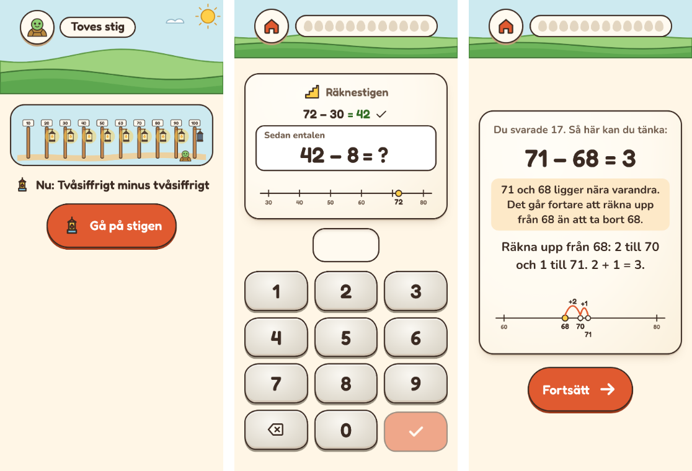

# Plan: tvåsiffrigt minus tvåsiffrigt (R4)

En nionde del på Stigen: 75 − 23, 72 − 38 och 71 − 68. Den kommer efter
”Tvåsiffrigt plus tvåsiffrigt” och får en lykta på stolpen vid 100.

## Varför

- **Det saknas.** Stigen har plus och minus över tiotalet och tvåsiffrigt plus,
  men inget tvåsiffrigt minus (första granskningen, [PLAN-GRANSKNING](PLAN-GRANSKNING.md#faser)).
- **Kursplanen** för åk 1–3 tar upp huvudräkning med de fyra räknesätten, och
  räknesättens samband ([LGR22](LGR22.md#taluppfattning-och-tals-användning)).
  Två sätt att tänka hör till minus: att ta bort och att räkna upp (skillnad).

## Bilder

*Telefon, 360 px. Till vänster stigen med nio lyktor, och djuret på väg mot den
sista vid 100. I mitten räknestigen för 72 − 38: tiotalen först, sedan entalen.
Till höger hjälpkortet efter fel svar på 71 − 68, med hoppen uppåt på tallinjen.*

## Hur

- **Delen ”Tvåsiffrigt minus tvåsiffrigt”** (`tvasiffrminus`). Den öppnar när
  tvåsiffrigt plus sitter. Det är samma hopp på tio, fast bakåt.
- **Tre sorters uppgifter, i den här ordningen:**
  1. **Utan att gå över tiotalet:** 75 − 23, 68 − 25, 89 − 34, 57 − 32, 96 − 41.
     Ta bort tiotalen, sedan entalen: 75 − 20 = 55, 55 − 3 = 52.
  2. **Över tiotalet:** 72 − 38, 63 − 27, 81 − 46, 54 − 29, 45 − 18, 90 − 36.
     72 − 30 = 42, 42 − 8 = 34, med steget ner till tiotalet: 42 − 2 = 40,
     40 − 6 = 34.
  3. **Tal nära varandra: räkna upp.** 71 − 68, 52 − 47, 83 − 79, 64 − 58. Från
     68 till 70 är 2, och till 71 är 1 till: 3. Att ta bort 68 vore en lång väg.
- **Tallinjen** visar hoppen bakåt (75 → 55 → 52), eller uppåt från det mindre
  talet (68 → 70 → 71) med hoppens storlek (+2, +1).
- **Räknestigen** börjar i ett steg: det första hoppet bakåt (75 − 20) eller upp
  till tiotalet (68 + __ = 70). De stegen hör till den nya delen och kommer först
  i den. Ett steg som en tidigare del redan har stannar där (47 + __ = 50).
- **Förväxlingen** ”minsta från största” får en egen förklaring: 72 − 38 = 46
  kommer av 8 − 2 i stället för 2 − 8. ”Det går inte att ta 8 från 2. Ta
  tiotalen först: 72 − 30 = 42, sedan 42 − 8.”
- **Stigens koll** får en kategori ”Tvåsiffrigt minus”.
- **QR-koden och sparade framsteg:** de nya uppgifterna läggs sist, och paketets
  version blir 2. En äldre kod läses som förut, och det nya börjar från början.
- **Den nionde lyktan** hänger på stolpen vid 100.

## Faser

| Fas | Innehåll |
|---|---|
| R4a. Innehållet **(klar)** | Delen, uppgifterna, stegen, strategierna, tallinjen, räknestigen, förväxlingen, kollen, lyktan, version 2. Enhetstester. |
| R4b. Verifiering **(klar)** | E2e, skärmbilder och dokumenten. Dalens simulering hoppades över: den skulle inte ändra något beslut. |

## Fallgropar

- **Gamla framsteg.** En nionde del får inte flytta något barn bakåt, eller låta
  delar öppna som inte ska. De nya uppgifterna är nya för alla.
- **Räkna upp är inte alltid bäst.** Bara när talen ligger nära varandra (högst
  10 isär). Annars blir det många små hopp.
- **Lyktorna** räknas på flera ställen (kartan, stigens sida, föräldravyn). Alla
  ska få nio.

## Fynd från R4a

- **29 nya uppgifter,** sist i paketet: 11 första hopp bakåt och 3 steg upp till
  tiotalet, 11 uppgifter att ta bort och 4 att räkna upp. Paketet har 253
  uppgifter i version 2. De 224 från version 1 har kvar sina platser, så att en
  äldre QR-kod läses som förut.
- **Stegen hör till den nya delen.** Hade 75 − 20 lagts i ”Hoppa tio” skulle den
  delens andel som sitter sjunka för barn som redan har den. Nu ändras inga gamla
  delar. Uppgiften visas ändå som det den är: hopp på tio, med hundrarutan och
  samma felsvar som i ”Hoppa tio”.
- **Den öppnar när tvåsiffrigt plus sitter,** inte samtidigt, så att de två
  delarna inte trängs om tiden. Med ett eller två frön gick det inte att se
  någon säker skillnad mellan de två sätten.
- **Den är svårast på stigen.** I Stigens egen simulering, med åtta frön under
  ett halvår, svarar ett genomsnittligt barn rätt på 78 % mot 79,5 % utan den.
  Tvåsiffrigt plus sitter till 74 % mot 76 %, och det skiljer 42–92 % mellan
  frön. Testernas gränser är sänkta med det som skäl.
- **Felsvaren:** 72 − 38 = 46 (minsta från största), 75 − 23 = 72 (tiotalen
  glömda) och ett tiotal fel. Varje felsvar har en egen förklaring.
- **Kollen** har två uppgifter till, sist, så att de andra sorterna dras som förut.
- **Den nionde lyktan** hänger på stolpen vid 100.

## Fynd från R4b

- **E2e-testet** (`e2e/stigen.spec.ts`) ger ett barn alla nio delar. Det går
  igenom räknestigen för 72 − 38 (72 − 30, sedan 42 − 8) och svarar fel på
  71 − 68. Hjälpkortet visar att räkna upp, med hoppen +2 och +1 på tallinjen.
  Efter felet kan 71 − 68 komma som räknestig: 68 + 2, 71 − 70, 2 + 1.
- **Tallinjen:** 70 och 71 skrevs ihop till ”7071”, eftersom hoppen är ritade i
  skala. Nu hamnar ett tal en rad lägre när det står för nära talet före. Det
  gäller alla tallinjer på Stigen, också 79 + 1 = 80.
- **Hjälpkortet** sa samma sak två gånger för tal nära varandra. Förklaringen
  till felet säger nu varför man räknar upp, och strategin hur.
- **Den nionde lyktan** ryms på alla storlekar (320, 360, 800 × 360, 1080). Vid
  den sista lyktan stod djuret på ramens kant. Nu står det före stolpen.
- **Ingen sidledsscroll** på stigens sida i någon av storlekarna.
