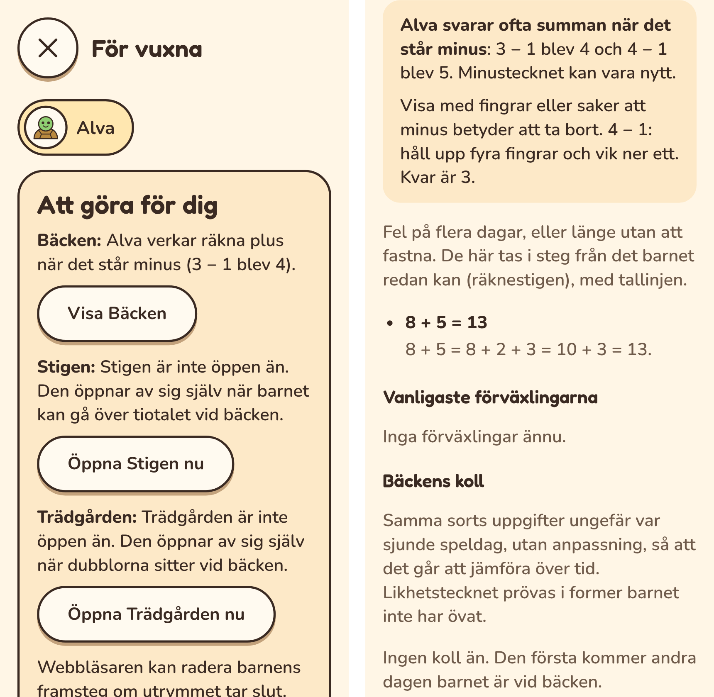

# Plan: minustecknet och rimliga svar

En 6-åring som precis har börjat med matte fick de lättaste minusfakta under
”Svåra just nu”: 1 − 1, 2 − 1, 3 − 1. Svaren visade varför. Barnet räknade plus
när det stod minus (2 − 1 blev 3, 4 − 1 blev 5). Bland förväxlingarna stod också
0 + 4 med svaret 695, sju gånger.

## Varför

- **Minustecknet är nytt för en del barn.** Bäcken blandar plus och minus från
  första frågan. Den är byggd för 7–9 år, för barn som har mött minus i skolan.
- **Appen ser inte mönstret.** Efter varje sådant fel står det ”3 är 2 + 1. Här
  ska det vara minus.” Det hjälper inte ett barn som inte vet vad minus betyder.
  Den vuxna får en lista med elva ”svåra” fakta, men ingen förklaring.
- **Ett fel svar blir ett svarsalternativ.** Svar som barnet har gett förut läggs
  till bland alternativen, så att förväxlingen övas. Ju oftare ett svar väljs,
  desto oftare kommer det tillbaka. Ett barn som tycker att 695 är ett roligt tal
  får det som alternativ igen och igen. Så blev det sju gånger.
- **Knappsatsen tar tre siffror.** Inget svar vid bäcken är större än 20.

De minsta fakta (1 − 1, 2 − 1) tas aldrig som räknestig. De saknar steg. Det
jag först trodde om räknestigen på knappsatsen stämde alltså inte.

## Hur

### A. Mönstret för den vuxna

- **Mönstret:** under de senaste 14 dagarna har minst tre olika minusfakta fått
  summan som svar, till exempel 2 − 1 = 3, 4 − 1 = 5 och 3 − 1 = 4. Fakta med
  minus noll räknas inte, eftersom 5 − 0 och 5 + 0 är lika.
- **Bäckens sida:** under ”Svåra just nu” står först en förklaring: barnet svarar
  ofta summan när det står minus, med två exempel. Där står också ett tips: visa
  med fingrar eller saker att minus betyder att ta bort. Fakta som mönstret
  förklarar står inte i listan under.
- **”Att göra för dig”:** samma sak kort, med knappen ”Visa Bäcken”. Den
  försvinner när den vuxna har sett Bäckens sida. Finns mönstret kvar två veckor
  senare kommer den tillbaka.
- **Det går över av sig själv:** slutar barnet svara summan försvinner mönstret
  efter 14 dagar, både på sidan och i ”Att göra”.

### B. Rimliga svar

- **Bara rimliga fel blir svarsalternativ.** Ett tidigare fel svar läggs bara
  till bland alternativen om det kan vara ett svar på platsen. Vid bäcken är det
  0–20, på Stigen och i trädgården 0–100. Ja och nej räknas alltid.
- **Knappsatsen tar så många siffror som platsens största svar:** två vid
  bäcken, tre på Stigen och i trädgården.
- **Förväxlingarna i ”För vuxna”** visar bara rimliga svar. 695 är ingen
  förväxling.

## Faser

| Fas | Innehåll |
|---|---|
| MA. Mönstret **(klar)** | Mönstret, förklaringen på Bäckens sida och ”Att göra”. Enhetstester och e2e. |
| MB. Rimliga svar **(klar)** | Svarsalternativen, knappsatsen och förväxlingarna. Enhetstester och e2e. |

En lugnare start för nybörjare, med plus först och minus när plus sitter, är ett
eget beslut (C): [PLAN-PLUSFORST](PLAN-PLUSFORST.md).

## Fallgropar

- **Inte varje fel är mönstret.** Ett barn som slarvar en gång ska inte få en
  förklaring. Därför krävs tre olika fakta.
- **Svarsloggen slås ihop** efter cirka 3 500 svar, men 14 dagar är långt färre.
- **Förväxlingar som redan finns** ligger kvar i barnets data. De slutar bara att
  bli alternativ och att visas. Inget raderas.

## Fynd från MA

*Telefon, 320 px. Till vänster ”Att göra för dig” med knappen ”Visa Bäcken”.
Till höger förklaringen överst under ”Svåra just nu”. Bara 8 + 5 står kvar i
listan; minusfakta som mönstret förklarar är borta.*

- **Mönstret** läses ur svarsloggen för de senaste 14 dagarna. Det behövs inga
  nya data, och inget sparas om barnet utöver dagen den vuxna såg sidan.
- **Exemplen** är de senaste felen, ett per fakta.
- **”Att göra för dig”** har en ny sorts rad: en knapp som öppnar platsens egen
  sida, där saken förklaras. Den försvinner när sidan har setts.
- **Det som barnet ser är oförändrat** i den här fasen. Hjälpkortet säger
  fortfarande ”Här ska det vara minus”. Det som ändras för barnet kommer i MB
  och, om det behövs, i C.

## Fynd från MB

- **Svarsalternativen:** ett tidigare felsvar blandas bara in om det kan vara
  ett svar i platsens paket. Gränsen räknas ut ur paketet själv: det största
  svaret är 20 vid bäcken och 100 på Stigen och i trädgården. Enhetstestet
  ger 0 + 4 felsvaren 695 (sju gånger) och 5 (en gång). 695 kommer aldrig med
  bland alternativen, och 5 kommer med i mer än hälften av frågorna.
- **Knappsatsen** tar lika många siffror som det största svaret: två vid bäcken,
  i passet, på räknestigen, i startkollen och i kollen. Trycker barnet 6, 9
  och 5 står det 69.
- **Förväxlingarna och värmekartan** i ”För vuxna” visar bara rimliga felsvar,
  på alla tre platserna.
- **Inget raderas.** 695 ligger kvar i barnets data, men används inte och visas
  inte.
