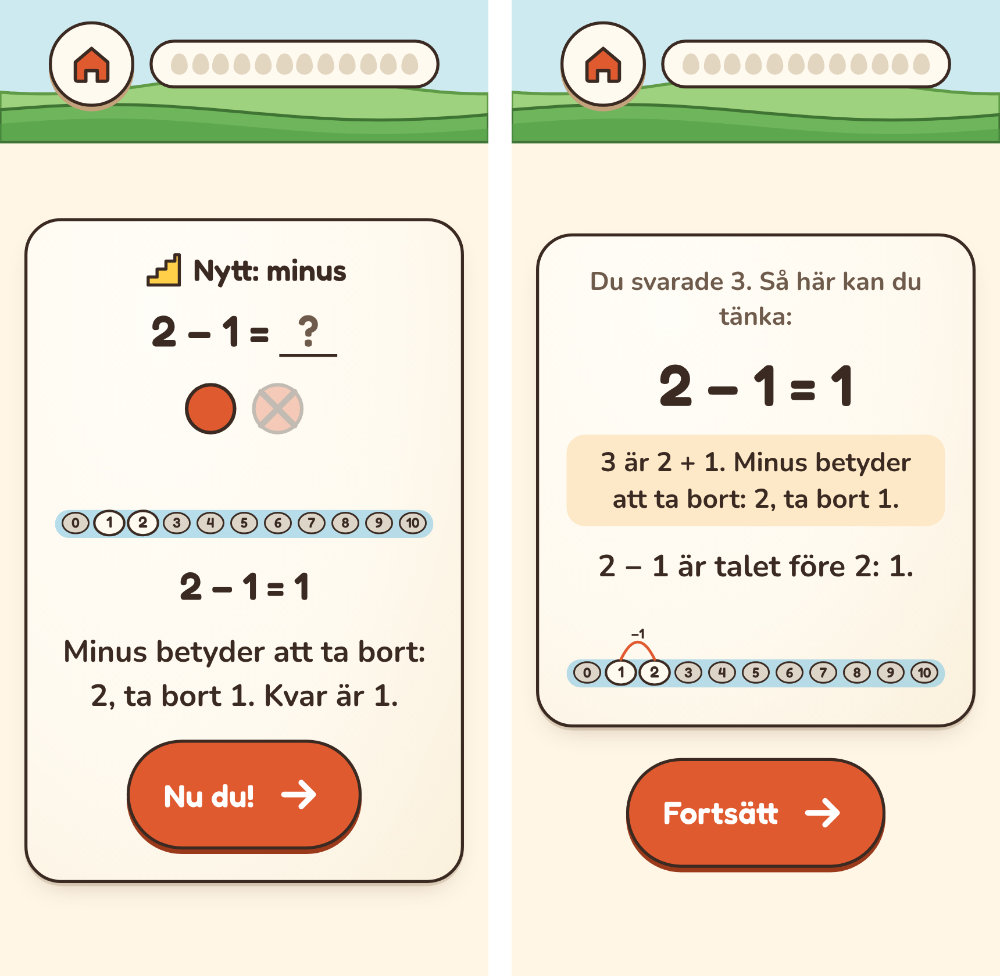

# Plan: plus först vid bäcken (C)

Ett barn som inte har mött minustecknet ska få plus först. Minus kommer när
plus sitter, och första gången med ett kort som visar att minus betyder att ta
bort.

## Varför

- **Minus från första frågan.** Bäcken lägger en hel familj i samma del: 8 + 5,
  5 + 8, 13 − 5 och 13 − 8. Ett nytt barn kan få 2 − 1 som andra eller tredje
  fakta. Det fungerar för en 7–9-åring som har mött minus i skolan.
- **En 6-åring räknade plus på minus** ([PLAN-MINUSTECKNET](PLAN-MINUSTECKNET.md)).
  MA visar det för den vuxna, och MB tog bort gissningarna bland alternativen.
  Men appen lär fortfarande inte ut vad minus betyder.
- **Delat med gör redan så.** En division kommer först när båda gångerfakta i
  familjen sitter (`requires` i `division.ts`). Minus kan vänta på plus på samma
  sätt. Motorn har stödet; bara innehållet ändras.

## Hur

### Minus väntar på plus

- **Varje minusfakta får familjens plusfakta som krav** (`requires`):
  13 − 5 och 13 − 8 kommer när 8 + 5 och 5 + 8 sitter. I en dubbelfamilj finns
  bara en plusfakta (4 + 4 före 8 − 4).
- **Ingenting annat i ordningen ändras.** Delarna, deras ordning och när de
  öppnas är desamma. Inom en del kommer plus först, och minus fylls på när plus
  sitter.
- **Det gäller alla barn,** inte en inställning. Ett barn som kan plus märker
  det knappt: plus sitter snabbt, eller redan efter startkollen, och då kommer
  minus som förut.
- **Barn som redan har börjat:** minusfakta som redan är igång fortsätter. Bara
  nya minusfakta väntar på sin plusfamilj.
- **QR-koden och sparade framsteg** ändras inte. Inga fakta byter plats eller id.

### Första minus: ett kort som visar ta bort

- **Första gången ett barn får en minusfakta** kommer ett eget introkort före den
  vanliga: ”Minus betyder att ta bort.” Det visar ett litet tal, till exempel
  4 − 1: fyra stenar, och en hoppar bort. Sedan hoppet bakåt på tallinjen.
  Kortet läses upp om uppläsningen är på.
- **Det visas en gång per barn,** när den första minusfaktan introduceras. Det
  behövs ingen ny data: det är första gången om barnet inte har någon minusfakta
  igång.

### Hjälpen efter plus på minus

- **Hjälpkortet** säger i dag ”3 är 2 + 1. Här ska det vara minus.” Det blir:
  ”3 är 2 + 1. Minus betyder att ta bort: 2, ta bort 1.” Bilden med hoppet bakåt
  finns redan på kortet.

## Faser

| Fas | Innehåll |
|---|---|
| C1. Minus väntar på plus **(klar)** | Kraven på minusfakta. Enhetstester. Simulering före och efter. |
| C2. Det barnet ser **(klar)** | Kortet för första minus och den nya hjälptexten. E2e, skärmbilder och dokumenten. |

### Simuleringen i C1

Bäckens och dalens simulering, med åtta frön och tre elever (genomsnittlig,
svag och långsam), före och efter:

- vecka när Trädgården öppnar (dubblorna sitter) och när Stigen öppnar (över
  tiotalet sitter);
- andel minusfakta som sitter efter 8 och 26 veckor;
- hur många minusfakta som väntar på sin plusfamilj, vecka för vecka.

Simuleringen kan visa vad det kostar i tid. Den kan inte visa nyttan, eftersom
den simulerade eleven inte blandar ihop plus och minus. Nyttan syns först hos
riktiga barn.

## Beslut

1. **Bara den första plusfaktan** (8 + 5 före 13 − 5 och 13 − 8). Planen sa båda,
   som delat med, men då öppnade Stigen ungefär fyra veckor senare i
   simuleringen. Med den första blev det ungefär en vecka (se fynden).
2. **Alla barn.** Det märks knappt för barn som kan plus.

## Fallgropar

- **Långsamma barn.** En plusfakta sitter först när barnet svarar snabbt nog
  (buske). Ett barn som räknar rätt men långsamt kan vänta länge på minus. ”Ge
  mer tid” hjälper, och simuleringen med den långsamma eleven visar hur länge.
- **Delarna öppnas efter 80 %.** Om minus kommer senare tar det längre tid innan
  en del når 80 %, och då öppnas nästa del senare. Det är det simuleringen ska
  mäta.
- **E2e-tester** som räknar med en minusfakta tidigt vid bäcken kan behöva ändras.
- **Mönstret från MA finns kvar.** Det fångar barn som redan har minus igång,
  och barn där kortet inte räckte.

## Fynd från C1

- **Regeln:** varje minusfakta har den första plusfaktan i sin familj som krav
  (`requires`), som delat med har sina gångerfakta. 13 − 5 och 13 − 8 väntar på
  8 + 5, och 8 − 4 på 4 + 4. Enhetstestet visar att ett nytt barn bara får plus
  den första dagen, eftersom en plusfakta blir buske tidigast dag två.
- **Startkollen hade slutat fråga.** Den hoppade över varje del där någon fakta
  väntar på andra, vilket var till för delat med. Med den nya regeln hade den
  hoppat över alla Bäckens delar. Nu hoppar den bara över delar där alla fakta
  väntar. Det gäller fortfarande delarna med delat med, och startkollen vid
  bäcken frågar som förut, minus också.
- **Simuleringen,** hela dalen, åtta frön, 26 veckor, median (min–max)
  (`PLUSFORST_REPORT=1`, `tests/simulation/plusforstReport.test.ts`):

  | Genomsnittlig elev | Som förut | Efter första plus | Efter familjens plus |
  |---|---|---|---|
  | Trädgården öppnar, vecka | 5 (4–7) | 5 (3–8) | 6 (4–7) |
  | Stigen öppnar, vecka | 12 (10–16) | 13 (8–19) | 16 (10–17) |
  | Minus sitter, vecka 8 | 83 % | 72 % | 70 % |
  | Minus sitter, vecka 26 | 95 % | 93 % | 92 % |
  | Gånger sitter, vecka 26 | 74 % | 74 % | 75 % |
  | Rätt svar | 82 % | 82 % | 82 % |

  Den svaga och den långsamma eleven öppnar inte Stigen inom 26 veckor i någon
  av varianterna, och minus sitter ungefär lika mycket vecka 26 (svag 62, 60 och
  57 %, långsam 44, 49 och 46 %). Andelen rätt svar steg för båda: från 78 till
  80–81 % och från 90 till 93 %.
- **Kostnaden** är ungefär en vecka innan Stigen öppnar för ett genomsnittligt
  barn, och minus sitter senare de första månaderna. Efter ett halvår är
  skillnaden liten. Simuleringen kan inte visa nyttan: den simulerade eleven
  blandar inte ihop plus och minus.
- **Två simuleringstester ändrades,** med skälet i testet. Alla fakta vid bäcken
  hinner introduceras inom tio veckor, inte nio. ×3 startar utan att hållas i
  vissa frön redan före C1 (två av sex), och testet för hur länge tabellerna
  hålls utan taket kontrollerar nu kvadraterna och ×7–×8, som hålls 7–15 veckor
  i alla frön.
- **Barn som redan har börjat:** minusfakta som redan är igång fortsätter. Nya
  minusfakta väntar på sin plusfakta, som oftast redan sitter.

## Fynd från C2

*Telefon, 320 px. Till vänster kortet för barnets första minusfakta: två stenar,
den sista överkryssad, hoppet bakåt och ”Minus betyder att ta bort”. Till höger
hjälpkortet när barnet svarar summan, 3.*

- **Kortet ”Nytt: minus”** kommer före barnets första minusfakta, en gång. Om
  barnet redan har någon minusfakta igång kommer det inte. Det behövs ingen ny
  data: appen ser efter i barnets framsteg när passet börjar.
- **Stenarna** är lika många som talet man tar från, i rader om tio. De sista
  hoppar bort och blir svaga och överkryssade. Med reducerad rörelse är de
  överkryssade från början. Bilden är så stor som stenarna kräver, inte hela
  kortets bredd.
- **Uppläsningen** säger ”Nytt: minus. Minus betyder att ta bort. 2 − 1. 2, ta
  bort 1. Kvar är 1.”
- **Hjälpkortet** efter summan på en minusfakta säger vad minus betyder i
  stället för ”Här ska det vara minus”. Stigen har kvar sin gamla text, eftersom
  barnen där redan räknar med minus.
- **E2e-testet** ger ett barn alla plusfakta i ”Ett mer, ett mindre” och spelar
  tills kortet kommer. Det kontrollerar stenarna, de överkryssade och texten.
  Kortet och hjälpkortet ryms på 320 och 360 px utan sidledsscroll.
