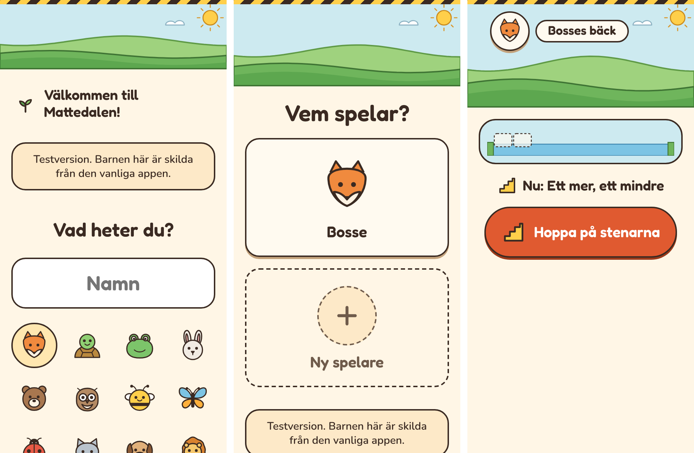

# Plan: en testversion före alla andra

En egen adress där nya saker kan provas innan alla får dem. Testversionen ligger
på **https://isacsvensson.github.io/Mattedalen/test/**. Den vanliga appen ligger
kvar på samma adress som förut.

## Varför

- **Allt som pushas når alla direkt.** En ändring som känns fel för ett barn
  märks först när andra familjer redan har den.
- **Ändringar i hur appen känns** behöver provas av riktiga barn innan de släpps,
  till exempel en ny första start eller färre ord.

## Hur

### Vilken gren som är vad (beslutat: A)

- **`main` är testversionen.** Allt som pushas till main hamnar på `/test/`.
- **`release` är den vanliga appen.** Den ändras bara när någon släpper.
- **Att släppa** betyder att `release` flyttas fram till samma version som main.
  Det görs på ett av två sätt:
  - säg ”släpp” till Claude, eller
  - på GitHub: *Actions → Släpp → Run workflow*. Det fungerar också i mobilens
    webbläsare.
- `release` flyttas bara framåt. Den får aldrig egna ändringar, så nästa släpp
  alltid går att göra.

### En sida, två versioner

Ett repo har bara en Pages-sida. Därför bygger publiceringen båda versionerna
varje gång och lägger testversionen i undermappen `test/`.

### Samma ställe för webbläsaren

Allt under `isacsvensson.github.io` räknas som samma ställe. Utan åtgärder skulle
testversionen dela data och sparade filer med den vanliga appen. Därför:

- **Egen databas:** `mattedalen-test`. Barnen i testversionen är skilda från de
  riktiga barnen, åt båda hållen.
- **Egna sparade filer:** testversionens cacher börjar på `staging-mattedalen-`.
  Den vanliga appen tar bara bort sina egna, `mattedalen-*`, och testversionen
  bara sina.
- **Den vanliga appens offlinedel lämnar `/test/` i fred.** Annars skulle den
  visa den vanliga appen på testadressen.
- **Eget märke för ”tillbaka dit du var”** efter en uppdatering.

### Syns tydligt

- En gul och mörk rand längst upp på varje skärm.
- ”Testversion. Barnen här är skilda från den vanliga appen.” på ”Vem spelar?”
  och på första skärmen.
- Namnet ”Mattedalen test” på hemskärmen och i fliken.
- ”Testversion” först i versionen under ”Den här enheten”. Den följer också med i
  mejlet från ”Tyck till”, så att vi ser att synpunkten gäller testversionen.

## Faser

| Fas | Innehåll |
|---|---|
| Testversionen **(klar)** | Bygget i testläge, databasen, cacherna, offlinedelen, randen och texten, publiceringen av båda och ”Släpp”. E2e för att data och filer hålls isär. |

## Fallgropar

- **En telefon med en gammal version av den vanliga appen** kan visa den vanliga
  appen på `/test/` första gången. Den gamla offlinedelen känner inte till
  testversionen. Öppna den vanliga appen en gång och uppdatera, så fungerar
  `/test/` sedan.
- **GitHubs skydd för publicering** tillåter bara standardgrenen. Därför körs
  publiceringen alltid från main, även när det är `release` som har ändrats.
- **Ett släpp kan inte göras om release har egna ändringar.** Det ska den aldrig
  ha.

## Fynd från testversionen

*Telefon, 320 px. Randen längst upp och texten på första skärmen och på ”Vem
spelar?”. Inget sticker ut åt sidan.*

- **Bygget:** `vite build --mode staging` ger testversionen. Läget styr
  databasens namn, cacherna, märket för ”tillbaka dit du var”, namnet i
  manifestet och fliken, randen och texten.
- **Publiceringen** (`.github/workflows/deploy.yml`) bygger main som
  testversion och `release` som den vanliga appen, lägger ihop dem och
  publicerar. Den körs vid push till main, med knappen, och när ”Släpp” är klar.
- **”Släpp”** (`.github/workflows/release.yml`) flyttar `release` fram till main
  med knappen. En push direkt till `release` startar också publiceringen.
- **Ett fel som testerna hittade:** första gången `/test/` öppnas styrs sidan av
  den vanliga appens offlinedel. När testversionens egen tog över trodde appen
  att det var en uppdatering och laddade om sidan, mitt i när barnet skrev sitt
  namn. Nu räknar appen bara sin egen offlinedel.
- **Barnen från Gångerträdgården** följde först med till testversionen. Appen
  hämtar dem vid första starten, och testversionen gjorde likadant i sin egen
  databas. Det såg ut som samma databas, men var en kopia av Gångerträdgårdens
  gamla data. Nu hämtar bara den vanliga appen dem, och testversionen börjar utan
  barn. Barn som redan kopierats till testversionen tas bort där, under barnets
  inställningar. Det påverkar inte den vanliga appen.
- **Adressen utan snedstreck** (`/test`) gav den vanliga appen, med de riktiga
  barnen. Den vanliga appens offlinedel släppte bara förbi `/test/`, och för
  `/test` svarade den med sin egen app. Ändringar där gjordes alltså i den
  vanliga appen. Nu skickar offlinedelen `/test` vidare till `/test/`. Rättelsen
  sitter i den vanliga appens offlinedel och når telefonerna med nästa släpp.
  Fram till dess: använd adressen med snedstreck.
- **E2e** (`e2e/staging.spec.ts`): testversionen syns och heter rätt, barnen hålls
  isär i båda riktningarna, den vanliga appens offlinedel lämnar `/test/` i fred,
  båda har sina egna sparade filer, båda fungerar utan nät, barnen från
  Gångerträdgården följer bara med till den vanliga appen, och `/test` utan
  snedstreck öppnar testversionen. Testservern
  serverar båda, som på GitHub Pages.
