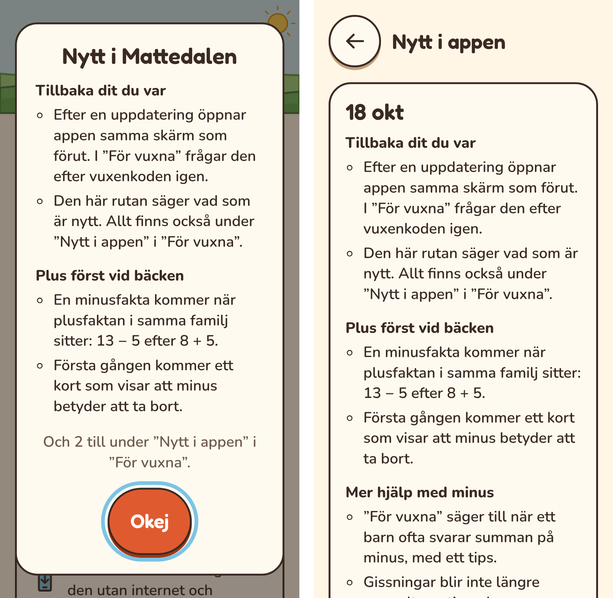

# Plan: efter en uppdatering

Två saker när appen har uppdaterats: man kommer tillbaka dit man var, och en
ruta säger vad som är nytt.

## Varför

- **Man hamnar på ”Vem spelar?”.** En ny version tas i bruk genom att sidan
  laddas om. Appen startar då alltid från början, vilket vill säga listan med
  spelare. Den som var i ”För vuxna” på en viss sida, eller vid en plats, får
  leta sig tillbaka.
- **Ingen vet vad som ändrades.** Knappen ”Ny version finns – uppdatera” säger
  inte vad som är nytt. Föräldrar som testar appen och lämnar synpunkter
  behöver veta vad som har ändrats sedan sist.
- **Inget lämnar enheten.** Båda delarna sparas lokalt, som allt annat.

## Hur

### Tillbaka dit man var (U1)

- **Var man är** sparas varje gång en skärm visas: vilket barn, och vilken skärm.
  Det är dalen, en plats, eller en sida i ”För vuxna” (översikten, en plats,
  barnets inställningar, den här enheten, hämta ett barn, tyck till eller fil
  till piloten).
- **Precis före omladdningen** för en uppdatering märks det att appen ska
  tillbaka dit. Det sparas i webbläsarens sessionStorage, som finns kvar när
  sidan laddas om i samma flik men inte när appen stängs.
- **Efter omladdningen** öppnar appen samma skärm för samma barn. Det gäller bara
  efter en uppdatering och bara om omladdningen kom inom fem minuter. En vanlig
  start börjar som förut på ”Vem spelar?”, så att syskon väljer själva.
- **”För vuxna” frågar efter vuxenkoden igen,** och öppnar sedan samma sida.
  Annars kunde ett barn hamna där efter en uppdatering.
- **Ett pass avbryts aldrig.** Det gör appen redan i dag: ingen uppdatering
  sker mitt i ett pass, en startkoll eller ett spel. Därför behöver inget
  pågående pass sparas.
- **Om skärmen inte finns längre,** till exempel om barnet har tagits bort eller
  platsen inte är öppen, går appen till närmaste skärm som finns: barnets dal,
  eller ”Vem spelar?”.

### Vad är nytt (U2)

- **En lista med nyheter i koden** (`src/shell/news.ts`). Varje post har ett id,
  ett datum, en rubrik och 1–3 korta punkter, skrivna för vuxna. En ny post
  läggs till i samma ändring som något synligt ändras.
- **Rutan ”Nytt i Mattedalen”** visas på första skärmen efter en uppdatering om
  det finns poster som enheten inte har sett. Den har knappen ”Okej”, och efter
  det visas den inte igen förrän nästa nyhet.
- **En sida i ”För vuxna”,** ”Nytt i appen”, med de senaste posterna. Den finns
  kvar för den som vill läsa igen.
- **En ny enhet** visar inte gamla nyheter. Vid första starten räknas allt som
  sett.
- **De första posterna:** ”Tyck till” i ”För vuxna”, att minus väntar på plus vid
  bäcken med kortet ”Nytt: minus”, att vuxna ser när barnet räknar plus på
  minus, och att gissningar inte blir svarsalternativ.

## Faser

| Fas | Innehåll |
|---|---|
| U1. Tillbaka dit man var **(klar)** | Var man är, märket före omladdningen, att öppna samma skärm, vuxenkoden. E2e med en simulerad uppdatering. |
| U2. Vad är nytt **(klar)** | Nyhetslistan, rutan, sidan i ”För vuxna” och de första posterna. E2e, skärmbilder och dokumenten. |

## Beslut som behövs

1. **Var rutan ”Nytt i Mattedalen” visas.** På första skärmen efter
   uppdateringen, vilken skärm det än är, utom under ett pass (beslutat). Rutan
   är skriven för vuxna, och om barnet är den som ser den räcker ”Okej”.
2. **Tillbaka även vid en vanlig start?** Nej, bara efter en uppdatering
   (beslutat). Annars hamnar ett syskon i fel barns dal.

## Fallgropar

- **sessionStorage kan saknas** eller vara avstängd, till exempel i privat läge.
  Då startar appen som förut.
- **En uppdatering kan komma när appen startar,** innan något barn är valt. Då
  finns ingen skärm att gå tillbaka till, och appen startar som förut.
- **Rutan får inte dölja ett pass.** Den visas inte under ett pass, utan på nästa
  skärm.
- **Nyheterna måste skrivas.** En ändring som barn eller vuxna ser behöver en
  post. Det läggs till i checklistan för varje fas.

## Fynd från U1

- **Var man är** (`src/shell/resume.ts`) sätts av skärmarna själva: ”Vem
  spelar?” (ingenting att komma tillbaka till), dalen, de tre platserna och de
  sju sidorna i ”För vuxna”. Skärmar under en plats, som ett pass, en ändskärm
  eller ”Öva en tabell”, behåller platsen. Efter en uppdatering kommer man alltså
  tillbaka till platsen, inte till passets ändskärm.
- **Märket** skrivs bara när sidan laddas om för en ny version (`pwa.ts`), också
  när uppdateringen väntade på att ett pass skulle bli klart. Det läses en gång
  vid starten och tas sedan bort, så nästa start är en vanlig start.
- **”För vuxna”** frågar efter vuxenkoden och öppnar sedan samma sida, med
  samma barn valt.
- **Reservvägar:** ett barn som inte finns ger ”Vem spelar?”, och en plats som
  inte är öppen ger dalen, med kartan vid den platsen.
- **E2e:** uppdateringstesterna (`e2e/update.spec.ts`) publicerar en ny version
  på riktigt. Från trädgården kommer appen tillbaka till ”Alvas trädgård”, och
  från ”Den här enheten” till vuxenkoden och sedan samma sida. En vanlig
  omladdning efteråt börjar på ”Vem spelar?”. Reservvägarna testas i
  `e2e/resume.spec.ts`.

## Fynd från U2

*Telefon, 320 px. Till vänster rutan efter en uppdatering, med de två senaste
posterna och var resten finns. Till höger sidan ”Nytt i appen” i ”För vuxna”.*

- **Nyhetslistan** (`src/shell/news.ts`) har fyra poster: tillbaka dit du var,
  plus först vid bäcken, mer hjälp med minus och ”Tyck till”. En test kräver
  att varje post har ett eget id, att de ligger med den senaste först och att
  ingen har fler än tre punkter.
- **Rutan** visas när appen startar, över första skärmen, om det finns poster som
  enheten inte har sett. Den visar högst två, så att den ryms på en liten
  telefon utan att knappen hamnar utanför, och säger hur många fler som finns
  under ”Nytt i appen”. Efter ”Okej” räknas alla som sedda.
- **Vem ser vad:** en ny enhet utan barn ser inga gamla nyheter. En enhet som
  redan har barn men aldrig sett någon post, alltså en som uppdateras till den
  här versionen, ser de två senaste.
- **Dialogrutorna** fokuserar knappen utan att scrolla, så en lång ruta visar
  sin rubrik först. Det gäller alla dialogrutor i appen.
- **Sidan ”Nytt i appen”** finns i ”För vuxna”, efter ”Den här enheten”, med
  posterna grupperade per dag. Den kommer också tillbaka efter en uppdatering,
  som de andra sidorna.
